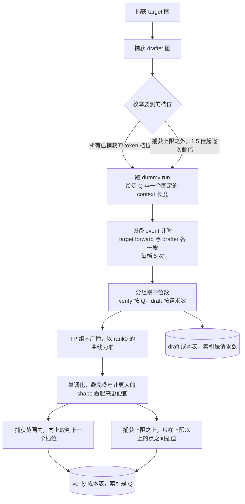
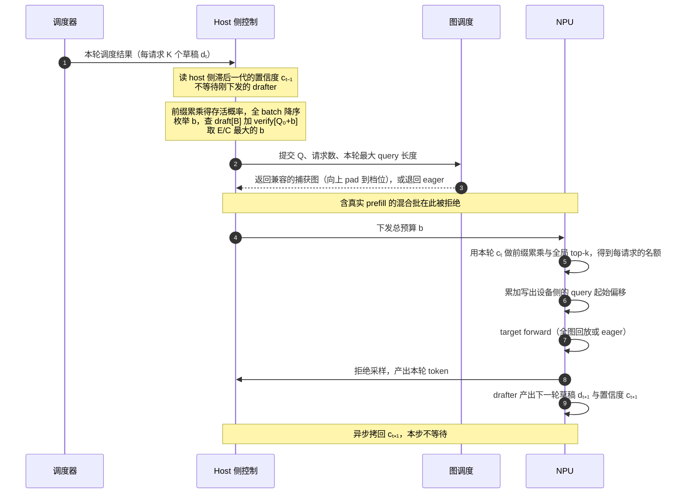

<!-- audit: skip=实践过程,成果固化 -->

# 在 Ascend NPU 上补齐 DSpark 动态校验：一次从算子到入图的完整排障

## 摘要

vLLM 上游已经为投机解码提供了动态校验（adaptive verification）：草稿模型在产出草稿的同一次前向里额外输出一个置信度，由它决定每个请求本轮保留多少 draft token，从而让 Target Model 这一步校验的 token 更少。我们要做的，是把这条能力在 Ascend NPU 上补齐到 Qwen3.6 + DSpark 这条路径。

这件事听起来像是一个策略问题：算出该裁多少，然后裁掉就是了。实际做下来，策略部分上游已经写好，我们几乎没有改动；真正的工作量落在三个它带来的连锁反应上。

第一，**裁剪让每个请求的 token 数不再相同**，而这条路径上的 GDN 与 Conv1D 算子，都是按「每请求固定 K+1 个 token」设计的。第二，**变长批次还要能进 ACLGraph**，而图是按固定形状预先捕获的，有状态算子的请求轴一变，状态的读写位置也跟着变。第三，**即使前两件都做对了，收益也不是连续的**：图按档位捕获，裁剪必须跨过一个档位才换得到时间。

本文按排查的顺序讲这三件事，中间穿插我们走过的弯路：一个看似普通的 shape 判断问题如何牵扯到 C++ 的编译与链接，一次「改对了但设备上没变化」的修复，以及一个到最后才发现不成立的正确性判据。

最终结果：Ascend 910B4、TP=4、4 个数据集 × 5 档并发的对照中，32 并发及以上 TPOT 下降 3.3%–13.6%，端到端时间下降 1.8%–13.0%；16 并发有 0.9%–1.8% 的轻微退化。

**关键词**：Ascend NPU、vLLM、投机解码、动态校验、ACLGraph、Gated Delta Net、变长算子、cost table

---

## 1 背景：为什么要做，以及已经有什么

### 1.1 投机解码里被浪费掉的那部分

投机解码的做法是让一个小模型先猜 K 个 token，再由 Target Model 一次性校验 K+1 个（K 个草稿加 1 个必得的 bonus）。猜对了就一次产出多个 token，猜错了就从错的那个位置重新开始。

关键在于，**猜错的概率不是均匀分布的，它沿着草稿位置急剧上升。** 下面是 K=7、96 并发下的实测，统计每个草稿位置被接受的频率：

| 草稿位置 | 1 | 2 | 3 | 4 | 5 | 6 | 7 |
| --- | ---: | ---: | ---: | ---: | ---: | ---: | ---: |
| ceval | 77.1% | 56.1% | 41.5% | 31.2% | 23.3% | 17.6% | 13.1% |
| gsm8k | 83.7% | 66.9% | 56.2% | 47.2% | 39.6% | 33.1% | 27.4% |

在 ceval 上，第 7 个位置只有 13.1% 的机会被接受，但它和第 1 个位置一样，占满一个校验槽位。把第 5 到第 7 个位置加起来，它们一共贡献 0.54 个 token，却占掉了 3/7 的校验开销。

固定 K 的问题就在这里：**它对所有请求、所有位置一视同仁。** 一个草稿质量很差的请求，和一个草稿几乎全对的请求，这一步花掉的校验预算完全一样。

动态校验要解决的就是这件事。

### 1.2 我们站在什么基础上

这项工作不是从零开始：

| 来源 | 提供了什么 |
| --- | --- |
| vLLM 上游的动态校验实现 | `AdaptiveVerificationManager`：cost table 的 profiling 与构建、预算计算、设备侧 top-k 名额分配。对应 vllm#47808 |
| vllm-ascend PR 15098 | DSpark 在 Ascend 上的投机解码主干，以及本文第 3 章要用到的两项前置：固定地址 buffer 加批收缩时清理 inactive tail、FIA 请求行数的 `B_live(+1)` 约定 |
| D-Cut 作者在 DFlash 侧的同一条路 | 入图契约的完整复盘：六个必须区分的 batch size、GDN 请求轴固定、padding 行的零长度约定、混合批不得强行进入变长全图。对应 vllm-ascend PR 15147、15207 |

[待补：D-Cut 文章链接]

也就是说，算法和入图契约都有人走通过。我们要补的是把它们落到 Qwen3.6 + DSpark 这条具体路径上，而这条路径有两个自己的特点：checkpoint 里带着一个此前没人用过的 confidence head，以及一个有状态的 GDN 算子。

---

## 2 动态校验是怎么工作的

### 2.1 裁多少，需要一个判据

有了逐位置的接受概率，一个直觉的做法是设一个阈值：概率低于某个值的草稿就裁掉。

这个做法有个问题：阈值定在哪里，没有依据。定高了裁太多，接受长度掉得厉害；定低了等于没裁。而且不同 batch、不同并发下，合适的阈值也不一样。

上游的做法是把它变成一个可以计算的问题：**这一步总共保留多少个 draft token，使「预期接受的 token 数 ÷ 这一步的耗时」最大。**

分子来自 confidence head。它是 checkpoint 里训练好的接受概率预测头，一个线性投影接 sigmoid，不是草稿 softmax 的最大值。

单个位置的概率不能直接用来排序，因为草稿是串行接受的：第 3 个位置能不能被接受，前提是第 1、2 个都被接受了。所以要做前缀累乘，得到这个位置真正被执行到的概率：

```
存活概率   s[i,j] = p[i,0] × p[i,1] × … × p[i,j]
```

把全 batch 所有位置的存活概率降序排列，保留前 b 个，就得到了这一步的预期接受数。分母查 cost table，于是整个决策写成：

```
预期收益   E(b) = N_sampling + （全 batch 的 s 降序排列后，前 b 项之和）
预计耗时   C(b) = draft_cost[B] + verify_cost[Q₀ + b]
本轮预算   b*   = argmax_b  E(b) / C(b)
```

其中 `B` 是本轮请求数，`Q₀` 是必须执行的非草稿 token 数（纯 decode 时等于 `B`），`N_sampling` 是本轮会产出采样 token 的请求数。

这里有两个容易读漏的地方。

**`draft_cost[B]` 为什么留在分母里。** 无论预算多少，DSpark 都会完整生成 K 个候选，裁剪只发生在校验侧，所以草稿成本在同一个 batch 内对所有 `b` 都是常数。既然是常数，看起来可以从比值里约掉，但不行：固定开销越大，多留几个 token 来摊薄它就越划算，它会改变最优点的位置。

**为什么是比值而不是差值。** 优化目标是单位时间的产出，不是「省下多少时间」。这个区别在后面第 2.4 节会变得很重要。

### 2.2 cost table 从哪里来

上面那个分母，是两张在启动阶段算一次、之后不再更新的查找表。

它们的来源是：图捕获完成之后，用一组 dummy batch 把每个档位的耗时实测一遍。



有几点需要说清楚，因为它们直接决定了这张表能用来回答什么问题。

**测的不是编图的时间，是图准备好之后跑 dummy workload 的时间。** 计时用的是设备流上的两个 event，一段包住 Target Model 的前向，一段包住 drafter 的 propose。

**它不是端到端时延。** 排队、调度器的 CPU 工作、在线的预算计算、真实的拒绝采样，都不在这两段区间里。设备 event 之间的间隔还会把 host 下发造成的空隙算进去。后面第 4 章给的 TPOT 和端到端数字，和这张表里的数字差一个量级，不能相减也不能互相换算。

**捕获上限之外的档位也要测。** 那些档位运行时会走 piecewise 或 eager，如果靠线性外推去估，会严重低估。但插值刻意不跨越图的边界：越过捕获上限意味着整张图失效，本来就是一个断崖，把两侧混在一起插值会抹掉这个真实的跳变。

**它是一个一维近似。** verify 表只以 Q 为索引，不区分每个请求的上下文长度、长度分布或实际执行模式，运行时也不重新标定。profiling 时每个 dummy 请求的历史长度是一个固定配置值，而线上各请求的上下文各不相同，还会随生成增长。所以不能把「表里 Q=512 是 120 毫秒」理解成线上每个 512 档都是这个耗时。对 Qwen3.6 这类混合结构，影响主要落在少数 full-attention 层上，GDN 这类线性注意力层的状态大小固定，与上下文长度无关。

### 2.3 置信度是哪一轮的

还有一个时序问题值得单独说，因为它解释了我们后面遇到的一次性能回归。

置信度是 drafter 在产出草稿时顺带算出来的，而这批草稿要到下一步才被校验。如果 host 要用它来定预算，就得等 drafter 算完、再把结果从设备搬回主机。

上游的做法是不等：host 用的是**上一轮**的置信度，设备侧分配每个请求名额时用的才是**本轮**的。



这个代差是设计上的选择，代价是 CPU 侧的置信度相对它正在为之定预算的那批草稿，又滞后了一代。

我们第一次把 confidence head 接上去跑整网时，TPOT 回归了 11%。方向是反的：裁剪少算了 token，单步应该更便宜才对。定位下来，是 `record_confidences` 里做了一次阻塞的设备到主机拷贝，把刚算完的置信度同步搬回来，而按上面的时序，host 这一步根本不需要它。改成侧流异步拷贝，设备侧顺手把非有限值修掉，单步从 18.10 毫秒回到 16.09 毫秒。

收益来自取消了一次主机等待，不是拷贝本身变快了。

### 2.4 为什么裁了不一定省

到这里，机制看起来已经完整：按存活概率排序，按 `E/C` 选预算，裁掉剩下的。

但有一件事会让所有这些努力落空。

ACLGraph 是按固定的几个尺寸预先捕获的，运行时一个批次要**向上补齐到下一个捕获档位**才能回放。也就是说，cost table 在捕获范围内不是一条连续的曲线，而是一个阶梯函数，**而台阶的边界，就是那些捕获档位**。

举个例子。假设捕获了 56 和 64 两档，当前这一步有 64 个校验 token：

```
verify 成本
   │                  ┌─────────────   Q 落在 (56, 64] 一律按 64 这一档计价
   │                  │
   │     ┌────────────┘                Q 落在 (48, 56] 一律按 56 这一档计价
   │     │
   └─────┴────────────┴──────────────→  Q
        48           56              64
```

裁到 60，Q 仍然落在 (56, 64] 这个区间，回放的还是 64 那张图，单步时间一点没变，而裁剪本身的开销照付。裁到 56，降了一档，这一步才真的变便宜。

**在这个例子里，裁掉 4 个 token 的收益是零，裁掉 8 个才开始有收益。**

这一点在实现和评估中都很容易被忽略，它有三个直接后果：

收益是台阶式的，不是连续的。「这一步裁掉了 6% 的草稿」和「这一步省了 6% 的时间」之间没有任何对应关系。

档位的疏密直接决定收益的可得性。档位越密越容易跨过台阶；档位越疏，就需要裁掉越多才换得到一次降档，而裁得越多，接受长度损失越大。

`E/C` 这个比值形式做的正是这件事。它不是在算「省了多少时间」，而是逐个候选预算地问：这个 `b` 能不能换到更低的一档，换到了之后，收益值不值被砍掉的那些 token。

形式化地说，同一个档位区间内 `C(b)` 恒定而 `E(b)` 随 b 单调增，所以最优点必然落在某个区间的上沿。controller 实际在做的决策是「选哪一档图」，而不是「选多少个 token」。

下面这个最小例子把这段算出来。2 个请求、K=3、`draft_cost[2]=3.0 ms`，verify 表为 `Q=2 → 10.0`、`Q=3..4 → 10.5`、`Q=5..8 → 16.0`。两个请求的存活概率分别是 A `[0.90, 0.72, 0.36]` 和 B `[0.20, 0.10, 0.05]`：

| b | Q | C(b) | E(b) | E/C |
| --- | --- | --- | --- | --- |
| 0 | 2 | 13.0 | 2.00 | 0.154 |
| 1 | 3 | 13.5 | 2.90 | 0.215 |
| 2 | 4 | 13.5 | 3.62 | **0.268** |
| 3 | 5 | 19.0 | 3.98 | 0.209 |
| 6 | 8 | 19.0 | 4.33 | 0.228 |

最优点 b=2 落在 `Q=3..4` 的上沿。b=1 和 b=2 的成本完全相同，所以没有理由停在 b=1；b=3 跨进了 19.0 那一档，多出来的 0.36 个期望 token 换不回这 5.5 毫秒。

如果把 `Q=5..8` 那一档从 16.0 改成 12.0，也就是台阶变矮，最优点会跳到 b=6，即完全不裁剪。台阶不够高的时候，不裁剪就是正确决策，这不是算法失效，是它算对了。

---

## 3 工程实现：让变长批次进得了图

### 3.1 从固定 K 到变长：GDN 和 Conv1D 需要做哪些改造

动态校验引入后，我们首先遇到的问题是：**原来的 GDN 和 Conv1D 算子，都是按照每个请求处理相同数量的 token 来设计的。**

以 K=7 为例，传统投机解码中，每个请求都会向 Target Model 提交 8 个 token（1 个原始 token 加 7 个 draft token）。无论一个 batch 里有多少请求，每个请求的长度都是固定的，因此算子可以直接按照这个固定长度计算数据和状态的存储位置。

但动态校验改变了这一前提。不同请求会根据各自的 confidence，决定本轮保留多少 draft token。例如，原本 3 个请求都需要校验 8 个 token，现在可能分别只需要校验 `[3,1,4]` 个。甚至在 ACLGraph 的固定请求槽位中，还可能出现长度为 0 的空请求。

这意味着，**算子不能再假设每个请求都有 K+1 个 token，而必须知道每个请求真正处理了多少 token，以及这些 token 在输入中位于什么位置。**

为此，我们没有直接修改原有的固定 K 算子，而是引入了两个独立的变长算子：`npu_dcut_causal_conv1d` 和 `npu_dcut_recurrent_gated_delta_rule`，由上层根据是否启用动态校验选择对应的路径。

对于 GDN，主要改动集中在请求边界和状态索引上。

原来的固定 K 路径使用 `actual_seq_lengths` 传递长度，并将 `ssm_state_indices` 通过 `.flatten()` 展平。由于每个请求的状态位置都按照固定窗口排列，这种方式在固定 K 下没有问题。

变长路径则使用 `query_start_loc` 表示每个请求的起始位置。例如，长度为 `[3,1,4]` 时，对应的偏移量就是 `[0,3,4,8]`，算子可以据此知道每个请求分别处理哪些 token。同时，`ssm_state_indices` 保留 `[B,S]` 的二维结构，每个请求仍然拥有固定宽度的状态索引表，但本轮实际使用多少列，可以因请求而异。

这里还有一个容易忽略的细节：**本轮处理的 token 数量，与上一轮接受的 token 数量，是两个不同的概念。**

GDN 是有状态计算。每轮开始时，需要根据 `num_accepted_tokens` 找到上一轮最终接受位置对应的历史状态，再以这个状态为起点处理本轮的新 token。

例如，某个请求上一轮接受了 6 个 token，但本轮动态校验只保留了 1 个。算子仍然需要从上一轮第 6 个接受位置读取历史状态，不能因为本轮只有 1 个 token，就把状态索引范围也缩短到 1。

因此，变长 GDN 的关键不仅是支持不同的 query 长度，还要保证状态索引表的宽度独立于本轮长度，避免读错历史状态。

Conv1D 面临的是类似问题。它需要维护一个随 token 生成而滚动更新的历史窗口。为了兼容动态校验，我们让算子在完成本轮计算后，将更新后的候选历史从状态缓冲区的起始位置连续写入。这样，无论下一轮接受了多少 token，都能从对应位置恢复正确的历史，而不依赖下一轮的 query 长度。

完成这些改造后，我们为两个算子编写了独立的 FP64 NumPy Golden 参考实现，并使用单卡测试逐项比对输出和更新后的状态。测试不仅覆盖常规长度和 `[3,1,4]` 这样的非均匀长度，还专门检查零长度请求、上一轮接受数大于本轮长度，以及连续多轮状态更新。

特别是多轮测试中，下一轮的参考状态始终来自 Golden 自己的计算结果，而不是从被测算子回读。这样才能避免第一轮的错误状态污染参考结果，确保真正发现跨轮累积的问题。

### 3.2 一个奇怪的 Golden 失败，暴露了两个隐藏问题

最初运行 Golden 测试时，我们遇到了一个很奇怪的现象。

四组 Conv1D 测试中，`[8]`、`[3,1,4]` 和 `[1,1,1]` 都能够正常通过，唯独 `[8,0,0,0,0,0,0,0]` 失败。

这组输入的含义并不复杂：整个 batch 预留了 8 个请求位置，但实际上只有第一个请求需要处理 8 个 token，另外 7 个请求都是空的。这种情况在动态校验配合固定形状的 ACLGraph 时并不罕见。

更奇怪的是，失败时第一个 token 的结果完全正确，而后面 7 个 token 的输出却不稳定，每次运行可能都不一样。

一开始，这很容易让人怀疑是算子计算精度、显存初始化，甚至 Golden 本身的问题。但沿着数据处理流程逐步检查后，我们发现问题其实出在更靠前的位置：**Host 侧的 tiling 从一开始就理解错了输入。**

Conv1D 算子在真正执行计算前，需要先由 Host 侧 tiling 确定每个请求的数据范围，再将这些信息交给设备侧 kernel。

原来的 tiling 实现为了兼容普通 Decode，做了一个默认假设：如果输入是二维张量，并且处于 Decode 模式，就先按照「每个请求对应一个 token」来理解输入。只有发现张量形状推导出的请求数，与 `query_start_loc` 提供的请求数不一致时，才切换到变长模式。

这个逻辑在普通 Decode 下没有问题，但遇到 `[8,0,0,0,0,0,0,0]` 时，就出现了一个巧合：输入一共有 8 个 token，`query_start_loc` 也描述了 8 个请求。

两边数量恰好相等，tiling 便认为自己的推断正确，没有切换到变长模式。

于是，原本应该分配给第一个请求的 8 个 token，被错误地理解成了 8 个请求各有 1 个 token。

这也解释了为什么测试结果如此奇怪。

第一个 token 恰好仍然落在正确的位置，因此计算结果正确。而后面 7 个 token 被错误分配给了 7 个空请求，这些请求对应的 `cache_indices` 都是无效的 pad 索引，kernel 会直接跳过它们。结果就是，后面 7 个 token 的输出根本没有被写入，读到的只是未初始化的显存。

整个过程没有触发异常，算子也正常返回了，只是输出悄悄错了。

回头再看其他三组测试，就能理解为什么它们没有暴露问题：`[8]` 和 `[3,1,4]` 的 token 总数与请求数不同，会正常触发变长模式；`[1,1,1]` 虽然两者相等，但每个请求确实只有一个 token，原来的假设刚好成立。

**只有当 token 总数恰好等于请求数，但每个请求的实际长度又不全是 1 时，这个问题才会暴露。**

定位到这里，第一次修复看起来很直接：既然 D-Cut Conv1D 已经明确提供了 `query_start_loc`，就应该始终以它为准，而不是通过输入形状猜测请求边界。

我们因此在共享的 Host tiling 中增加了一个编译期开关，只让新的 D-Cut 算子强制使用 `query_start_loc`，原有 Conv1D 算子仍保留原来的处理方式。设备侧 kernel 本身不需要修改，因为它原本就支持按照变长边界处理输入。

按理说，问题到这里就应该解决了。

**但重新编译、安装算子之后，设备上的测试结果居然没有任何变化。**

这让排查进入了第二阶段。

进一步检查编译和链接过程后，我们发现了一个更隐蔽的 C++ 问题：原算子和 D-Cut 算子虽然注册成了两个不同的算子名称，但它们复用的 Host tiling helper 仍然处于同一个命名空间。

更关键的是，这些 helper 都定义为 `inline` 函数。我们新加的开关修改了其中 `GetShapeDtypeInfo` 的实现，使得两个编译单元里出现了同名、但函数体不同的版本。

按照 C++ 的 One Definition Rule，这种情况本身就是不合法的。然而链接过程不一定会报告错误。对于这类 `inline` 函数，链接器可能只保留其中一份实现，而把另一份丢掉。

在我们的实际构建中，留下来的恰好是原版实现。也就是说，D-Cut 虽然设置了新开关，最终运行时却仍然执行旧的 shape 推断逻辑。

为了确认这一点，我们又构造了一个只有两个编译单元的最小复现：关闭优化时，设置了新开关的编译单元可能调用另一个编译单元的旧实现；开启优化后，由于函数被内联，两边反而各自使用了正确的实现。

这说明问题并不在于宏没有定义成功，而是**宏确实改变了源码，但修改后的函数实现没有被可靠地保留到最终二进制中。**

最终的修复是在 D-Cut 编译单元中为共享的 tiling helper 使用独立命名空间，让原算子和新算子生成不同的链接符号，彻底消除冲突。同时，我们增加了编译期检查：如果启用了新的布局策略，却没有隔离命名空间，就直接让编译失败，避免以后再次出现类似的静默错误。

修复完成并重新安装算子后，之前失败的 `[8,0,0,0,0,0,0,0]` 测试恢复正常，包含多轮 GDN 状态更新在内的 5 项单卡 Golden 测试全部通过。

回顾整个问题，真正有价值的并不只是修复了一个 Conv1D Bug，而是发现了两类容易被忽略的风险。

一方面，**变长计算不能依赖张量形状猜测请求边界**。尤其在 ACLGraph 固定捕获形状下，请求数和 token 数可能恰好相等，但这并不代表每个请求都只有一个 token。

另一方面，**源码修改正确，也不等于最终二进制一定执行了修改后的代码**。当不同算子通过复用源码来实现时，如果共享的 inline 函数因为编译选项产生了不同实现，就必须注意符号隔离，否则一次看似正确的修复，可能在链接阶段被悄悄覆盖。

这也是我们最终坚持使用独立 Golden、真实设备测试，以及最小编译复现来定位问题的原因：它们分别帮助我们确认数学结果、设备行为和编译产物，避免将不同层次的问题混在一起。

### 3.3 算子对了，图还没对：请求轴为什么不能跟着 batch 走

算子层面的问题解决之后，我们以为变长批次就可以直接进图了。实际上还差一层。

ACLGraph 的工作方式是：启动时按几个固定形状把计算图捕获下来，运行时把当前批次补齐到最接近的那个形状，然后回放。对无状态的算子，批次里有几个请求、每个请求多长，只影响这次计算的规模，补齐一些空行无非是多算一点。

但 GDN 不是无状态的。

每个请求在状态缓冲区里都有自己的槽位，算子要根据「这一批有几个请求」去定位每个请求的状态应该读哪里、写哪里。也就是说，**请求轴的宽度不只是一个规模参数，它参与了状态地址的计算。**

如果让请求轴跟着当前活跃的请求数走，那么同一个请求，在批次里有 16 个请求时和有 32 个请求时，状态的读写位置是不一样的。单看一轮不会出错，因为读和写用的是同一套规则；但请求数在轮与轮之间变化时，上一轮按 16 写进去的状态，这一轮会按 32 的规则去读。

这正是 D-Cut 作者在复盘里记下的故障形态：并发从小往大爬升的那段时间里，前面几批请求输出很短或者是乱码，等并发稳定下来之后又自己恢复正常。不抛异常，而且会自愈，所以很难归因。

解决办法是把 GDN 的请求轴固定为服务允许的最大并发数，所有图档位统一。即使当前只有 4 个活跃请求，后面的行也作为零长度、状态索引无效的空行保留下来。代价是每轮要多清理一些 metadata，换来的是所有档位共用同一套状态读写契约。

这里要区分的量其实有六个，把它们当成同一个数字是这一层最主要的错误来源：

| 名称 | 含义 |
| --- | --- |
| `B_max` | 服务允许的最大请求数 |
| `B_live` | 当前这一轮真实存在的请求数 |
| `Q` | 本轮实际处理的总 query token 数 |
| `B_graph` | 图描述符能容纳的请求数，等于 `min(Q, B_max)` |
| `B_fia` | Full Attention 看到的请求行数，等于 `B_live`，有 token padding 时是 `B_live + 1` |
| `B_gdn` | GDN 状态算子的请求轴，固定为 `B_max` |

我们在这里犯了一个错，值得记下来。

第一次实现时，我们只把 GDN 的请求轴钉死了，其余几条没有同步。改完之后在服务规模上跑，第一次拿到了有梯度的 cost table：16 并发下可达区间跨度 144 毫秒，32 并发下 263 毫秒。看起来是个好消息。

可那两轮的输出都和基线对不上。

首要嫌疑恰恰是刚钉死的那条轴。它在「最大并发等于活跃请求数」的时候是个空操作，而那正是它被引入时面对的形状，所以看起来无害。到了 16 和 32 并发，活跃请求只有两到四个，轴却钉在最大值上，这是它第一次真的产生 padding 行。

而这条规则所属的契约，是和注意力侧的请求行数、以及持久 `seq_lens` 镜像里的 padding 清理一起成立的，三处改动来自同一份复盘。

**只实现其中一条，不是更保守的做法，是一个半成品。**

于是我们把它改回 opt-in，默认退回到已经验证过的逐档位轴，等其余几条一起落地再打开。门槛脚本加了一个 `+axis` 后缀，下次可以直接二分它，而不是靠推理。

三天之后，同样的错误又犯了一次。

补齐其余几条、重新把轴钉回去之后，设备上报了一个张量形状不匹配：`16 vs 17`。来源是 FIA 的 padding 行，Full Attention 在有 token padding 时会多出一行，而逐请求的 buffer 只按 `max_num_reqs` 分配，那一行没有地方落脚。

把 buffer 加宽一行，不匹配消失了。我们顺手又做了第二件事：把 padding 行的 `seq_lens` 清零，让它在语义上也是一个空行。

这一步引入了正确性回归。原因是 GDN 侧有一个函数靠 `seq_lens == 0` 识别 padding 行，然后把 query 视图在第一个 inactive 行处截断。在清零之前，这个条件恒为假，函数从未真正执行过；清零让它第一次生效，于是 GDN 的请求轴又从固定的 `B_max` 变回了跟着活跃请求数走，正好推翻了上面那条规则。

我们回退了清零，并在原处留了一句注释说明为什么不能清。

两次错误的形状是一样的：契约里有四条并列的规则，我们每次只取其中一条，然后用加宽、清零这类局部修补去兜住剩下的部分。

### 3.4 混合批应该去哪里，以及为什么这是个测量问题

变长全图的契约是纯投机解码。一个正在做 prefill 的请求混进来，它的 query 长度是几百上千，和投机解码那种每请求几个 token 的几何完全不同。

识别方式很简单：比较「本轮被调度的请求」和「本轮带投机草稿的请求」两个集合的大小。prefill 请求出现在前者而不在后者，所以两者恰好在批次混合时不相等。

拒绝之后，这批请求该去哪里，有两个候选：另开一套 piecewise 图，或者退回 eager。

我们选了退回 eager，理由有两条。

第一条是工程上的：piecewise 要多编译一整套图，显存开销不可接受。

第二条是测量口径上的，而且更重要：**动态校验关闭的时候，混合批同样走 eager。** 如果只在开启的时候给它一套 piecewise，那么测出来的差值里就混进了一个配置选择，而不是这个特性本身的收益。

代价是明确的：这部分批次的时间仍然在图外。把 prefill 和 decode 拆成独立微批是正确的优化方向，但那是另一项工作。

---

## 4 结果

### 4.1 测量口径

先把口径说清楚，再看数字。

对比的两条路径是同一个引擎、同一个模型、同一份数据集、同一个并发，唯一的差异是是否开启动态校验。基线是现有的固定 K 投机解码路径，不调用动态校验的任何代码，而且它是一条已经被调优过的生产路径，不是为了对比临时写的。硬件为 Ascend 910B4，TP=4，草稿宽度 K=7。

两个指标都取整次运行的汇总平均：TPOT 按全部解码 token 平均，端到端按并发批平均。它们**包含** prefill、排队、调度、采样、拒绝采样、状态更新和通信，也就是服务侧能观测到的全部时间；它们**不包含**的部分同样要说清楚：第 2.2 节那张 cost table 测的只是设备事件之间的两段前向，不含排队、调度器的 CPU 工作、在线的预算计算和真实的拒绝采样。两者差一个量级，不能相减，也不能互相换算。

还有一件必须说的：**每个格子只跑了一次，预热次数、重复采集次数和波动范围都没有记录，所以本文给不出噪声底。** 这限制了可以下的结论：32 并发及以上的改善在 3% 到 13.6% 之间，跨 4 个数据集同向，不像噪声；而 16 并发那一档只有 0.9% 到 1.7%，在没有噪声底的情况下只能说明收益接近零，不足以断定符号。

[待补：补齐重复采集与波动范围]

### 4.2 数据

TPOT 单位毫秒，端到端单位秒，接受长度是每请求每步产出的 token 数。变化列为负表示开启动态校验后更快。

| 数据集 | 并发 | TPOT 关闭 | TPOT 开启 | TPOT 变化 | 端到端 关闭 | 端到端 开启 | 端到端变化 | 接受长度 关闭 | 接受长度 开启 |
| --- | ---: | ---: | ---: | ---: | ---: | ---: | ---: | ---: | ---: |
| **ceval** | 96 | 48.87 | 42.90 | −12.2% | 228.1 | 199.7 | −12.4% | 3.60 | 3.19 |
|  | 64 | 46.75 | 41.24 | −11.8% | 243.7 | 214.3 | −12.1% | 3.60 | 3.24 |
|  | 48 | 40.51 | 36.02 | −11.1% | 279.6 | 253.6 | −9.3% | 3.60 | 3.36 |
|  | 32 | 31.84 | 29.12 | −8.5% | 339.5 | 301.7 | −11.1% | 3.58 | 3.26 |
|  | 16 | 21.24 | 21.52 | +1.3% | 447.5 | 452.6 | +1.1% | 3.60 | 3.42 |
| **gsm8k** | 96 | 44.56 | 42.48 | −4.7% | 166.2 | 161.7 | −2.7% | 4.54 | 4.32 |
|  | 64 | 39.73 | 38.24 | −3.8% | 170.3 | 167.3 | −1.8% | 4.51 | 4.14 |
|  | 48 | 35.35 | 33.12 | −6.3% | 194.5 | 184.4 | −5.2% | 4.55 | 4.28 |
|  | 32 | 28.00 | 27.08 | −3.3% | 241.0 | 233.0 | −3.4% | 4.51 | 4.40 |
|  | 16 | 19.20 | 19.42 | +1.1% | 320.0 | 325.8 | +1.8% | 4.54 | 4.38 |
| **coding_zh** | 96 | 47.77 | 42.16 | −11.7% | 596.9 | 555.8 | −6.9% | 3.78 | 3.37 |
|  | 64 | 45.34 | 39.18 | −13.6% | 656.0 | 571.0 | −13.0% | 3.79 | 3.38 |
|  | 48 | 36.27 | 31.64 | −12.8% | 704.3 | 615.1 | −12.7% | 3.78 | 3.47 |
|  | 32 | 28.03 | 25.65 | −8.5% | 816.5 | 743.7 | −8.9% | 3.78 | 3.37 |
|  | 16 | 18.88 | 19.21 | +1.7% | 1095.8 | 1114.5 | +1.7% | 3.78 | 3.56 |
| **specbench** | 96 | 58.61 | 52.88 | −9.8% | 611.5 | 556.9 | −8.9% | 3.66 | 3.29 |
|  | 64 | 51.86 | 45.94 | −11.4% | 579.6 | 510.1 | −12.0% | 3.67 | 3.32 |
|  | 48 | 43.88 | 39.19 | −10.7% | 654.1 | 586.8 | −10.3% | 3.70 | 3.46 |
|  | 32 | 33.46 | 30.76 | −8.1% | 755.7 | 706.4 | −6.5% | 3.68 | 3.39 |
|  | 16 | 22.11 | 22.31 | +0.9% | 1003.1 | 1008.1 | +0.5% | 3.64 | 3.48 |

每个百分比只对照它自己那一行的关闭值，行与行之间不可相加；TPOT 和端到端是同一组运行的两个口径，也不能相减。

96 并发那一行的端到端需要单独说明。同一组运行里，基线的 TTFT 在 48 和 64 并发是 0.9 到 1.6 秒，到 96 并发跳到 19.7 到 58.2 秒。端到端把这段 prefill 排队也算进去了，而动态校验只作用于解码侧，所以那一行的端到端改善小于同一行的 TPOT 改善。这是稀释，不是收益变弱。

**怎么确认真的走到了新路径。** 只看上面这张表，无法区分「动态校验生效了」和「它被构造出来但从未裁剪」。我们在引擎里按窗口聚合打印三个量：本窗口保留的草稿比例、每一步实际派发到的图模式、置信度真正发生过变化的步数。判定条件是三者同时成立，出现保留比例低于 100% 的窗口、这些窗口的步命中全图、置信度每步都在变化。任一不成立就记为无效运行，而不是记为收益。

### 4.3 数据里的两条规律

**第一条：16 到 32 之间有一个拐点，此后进入平台期。**

以 TPOT 为例，每个数据集从 16 并发到 96 并发：

```
ceval      +1.3%  →  −8.5%  → −11.1%  → −11.8%  → −12.2%
coding_zh  +1.7%  →  −8.5%  → −12.8%  → −13.6%  → −11.7%
specbench  +0.9%  →  −8.1%  → −10.7%  → −11.4%  →  −9.8%
gsm8k      +1.1%  →  −3.3%  →  −6.3%  →  −3.8%  →  −4.7%
            cc16      cc32      cc48      cc64      cc96
```

16 到 32 之间是一次阶跃，32 以上就进入平台，并不继续上升。

拐点可以从第 2.4 节推出来。并发小的时候，单步时间由与校验 token 数无关的固定开销主导，可达的 Q 区间里 `E/C` 曲线接近水平，最优点自然落在不裁附近；此时动态校验自身的决策开销（置信度处理、host 侧枚举、设备 top-k）反而成了净损失，于是出现 16 并发下的轻微退化。批次变大之后，随 Q 变化的那部分在单步时间中占比上升，跨档位的跳变也变大，裁剪才开始有东西可省。

平台期则说明可降的档位在 32 并发时就基本用满了。能降多少档由两件事共同决定：可裁空间（由逐位置接受率决定，不随并发变化），以及批次所处位置附近捕获档位的疏密。并发继续增大只是把 Q 推到更高的档位区间，这两件事都不会变好。

**第二条：起草越准，可裁的越少。**

gsm8k 在所有并发下收益都最小，TPOT 只改善 3.3% 到 6.3%，其余三个数据集在 8.1% 到 13.6% 之间。

原因在第 1.1 节那张表里：gsm8k 的第 5 到第 7 个草稿位置贡献 1.00 个 token，ceval 只有 0.54 个，可裁的空间差了近一倍。接受长度的降幅也呈现同样的分布，gsm8k 只降了 4.8%，其余三个数据集在 10.1% 到 11.4% 之间。

两者逐数据集对应，这把收益归因到了「用接受长度换更低的图档位」这条路径上，而不是别的什么。

这条规律有一个实际后果：**用数学题类数据集评估动态校验，会系统性低估它。** 选评测集时需要让起草难度覆盖真实业务分布。

---

## 5 总结与边界

我们把上游的动态校验落到了 Qwen3.6 + DSpark 这条 Ascend 路径上：启用了 checkpoint 里原本闲置的 confidence head，补齐了变长 GDN 与变长 Conv1D 算子，按参考复盘的入图契约让裁剪后的变长批次能够回放已捕获的全图。配置入口只有 `enable_adaptive_verification: true` 一项，不需要额外的环境变量。

### 5.1 四条可以带走的判断

**「能裁」和「有收益」是两件事，而且后者是离散的。** 策略层再准，如果 cost table 在服务可达的 Q 区间内是平的，裁剪就不改变单步时间；即便曲线有梯度，裁剪也必须跨过一个捕获档位才兑现得了收益。所以评估这类优化时，要问的不是「平均裁掉了百分之多少」，而是「有多少步真的落到了更低的一档」。

**对有状态算子，shape 变化不只是性能问题，还会改变状态读写契约。** 对无状态算子，缩小 shape 往往只是少算一点；GDN 这类算子的请求轴参与了状态地址的计算，轴一变，上一轮写进去的状态这一轮就读不对。代价换法是明确的：用一点 metadata 清理成本，换所有档位共用一套状态契约。

**契约要整条实现，不能只取其中一条。** 我们在这上面栽了两次，中间隔了三天。钉死请求轴是契约里的一条，padding 行的处理是另一条，混合批的去处是第三条。两次都只取了一条，然后试图用加宽、清零这类局部修补去兜住剩下的部分。只实现三分之一，不是更保守，是一个半成品。

**源码改对了，不等于最终二进制执行的是改后的代码。** Conv1D 那个开关在源码里完全正确，设备上跑的却是另一份实现，而丢掉的那一刻没有任何诊断。跨编译单元共享的 `inline` 函数、同名符号、按条件编译出的不同实现，这几样凑在一起时，「我改了」和「设备上跑的是我改的」之间需要一条独立的证据链：一个探针、一个最小复现，或者一道让错误配置编译不过的检查。

### 5.2 已知边界

- **16 并发附近是收益的临界区。** 上表在该档位给出 0.9% 到 1.7% 的退化；我们在另一个数据集、另一个指标下测到过小幅正收益。两者并不矛盾，在这个量级上收益接近零且符号不稳定，不应把任何一侧当作定论。需要在低并发下部署时，应当按自己的数据集重测。
- **收益有上限，32 并发之后不再增长。** 可裁空间由逐位置接受率决定，而那条曲线不随并发变化。想进一步提升，方向不是加大批次，而是提高 confidence head 的判别力，或者减少第 2.2 节那些动态校验碰不到的固定开销。
- **混合批仍在图外。** 含真实 prefill 的批次退回 eager，这部分时间没有被改善。
- **cost table 是启动时的一维近似。** 它只以 Q 为索引，不随线上上下文长度更新，也不在运行时重标定。长上下文部署下，表值与真实耗时的偏离需要用实际 workload 验证。
- **结论限于 greedy 采样。** 随机采样路径未验证。
- **逐 token 等价不是一个可用的正确性判据。** 我们一度用「与固定 K 基线逐 token 相等」做验收，后来发现在服务规模的并发下，去掉动态校验的参考实现自己就不可复现：同一个引擎内连续采样 8 次，产出 4 种不同的输出，最早的分歧出现在第 2 个 token。这条对任何打算用逐点相等做验收的人都适用。量具必须和被测对象一样被怀疑，先确认参考自身可复现，再去判定被测对象。

### 5.3 下一步

1. 补降档计数，在日志里把「裁了」和「裁了并且降了档」分开。当前的保留比例回答不了后一个问题，而那才是和收益直接相关的量。
2. 拆分 prefill 与 decode 微批，回收混合批这部分时间。
3. 在算子级 profile 上确认单步时间里与 Q 无关的那部分由什么构成。
