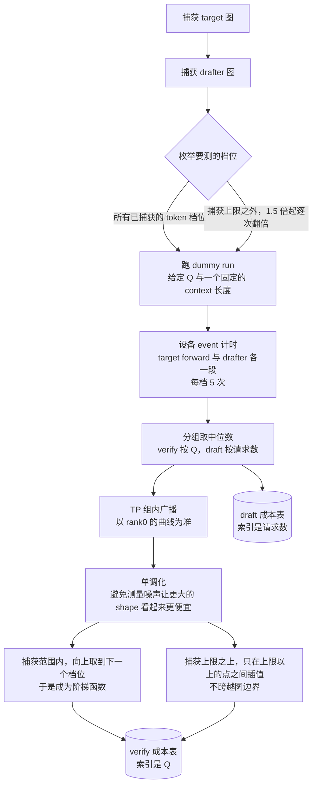
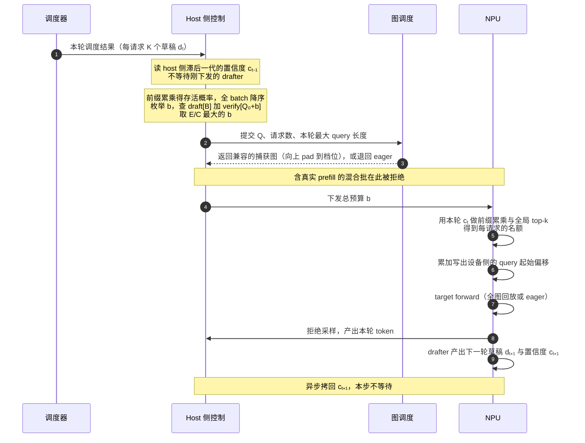

# 在 Ascend NPU 上补齐 DSpark 动态校验与变长 GDN 入图

## 摘要

vLLM 上游已经为投机解码提供了动态校验（adaptive verification）的能力：草稿模型在产出草稿的同一次前向里额外输出一个置信度，controller 据此逐请求裁掉那些注定被拒的草稿，让校验批次变短。我们要做的是把这条能力在 Ascend NPU 上补齐到 Qwen3.6 + DSpark 这条路径上。

缺口有三个：**其一**，DSpark 的 checkpoint 里带了 confidence head，而我们之前的实现没有用上它，草稿宽度始终是固定的 K；**其二**，裁剪会让每个请求的 query 长度不再相等，而这条路径上的 GDN 算子、图描述符和状态契约全都是按「每请求 K+1 个 token」设计的，变长批次进不了图；**其三**，在 eager 下裁剪不产生任何时间收益——单步成本几乎不随校验 token 数变化，所以「能裁」和「有收益」是两件事，必须先入图再谈收益。

本文先讲清动态校验的算法与 cost table 的构建方式，再说明我们为让变长批次进入全图所做的工程改动，最后给出实测结果。在 Ascend 910B4、TP=4、4 个数据集 × 5 档并发的对照中：**32 并发及以上，单 token 增量时延（TPOT）下降 3.3%–13.6%，端到端时间下降 1.8%–13.0%；16 并发则有 0.9%–1.8% 的轻微退化。** 收益在 16→32 之间有一个明显拐点，此后进入平台期而不再继续上升；同时它随起草准确度下降。两条规律都源自同一个机制：**图是按固定尺寸预先捕获的，裁剪必须跨过一个捕获档位、让这一步落到更低的一档，才会真的省下时间**——裁了但没降档，就是白裁。

**关键词**：Ascend NPU、vLLM、投机解码、动态校验、ACL Graph 全图回放、Gated Delta Net、变长算子、cost table

---

## 1 背景：已有的基础，与要补的缺口

### 1.1 我们站在什么基础上

这项工作不是从零开始，它站在三组已有成果上：

| 来源 | 提供了什么 |
| --- | --- |
| vLLM 上游的动态校验实现 | `AdaptiveVerificationManager`：cost table 的 profiling 与构建、`E/C` 比值预算、设备侧 top-k 名额分配。上游对应 PR：vllm#47808 |
| vllm-ascend PR 15098 | DSpark 在 Ascend 上的投机解码主干，以及本文第 3 章要用到的两项前置：固定地址 buffer + 批收缩时清理 inactive tail、FIA 请求行数的 `B_live(+1)` 约定 |
| D-Cut 作者在 DFlash 侧的同一条路 | 入图契约的完整复盘：六个必须区分的 batch size、`B_gdn` 固定轴、padding 行的零长度约定、混合批不得强行进入 ragged FULL。对应 vllm-ascend PR 15147、15207 |

[待补：D-Cut 文章链接]

换句话说，**算法本身与入图契约都已经有人走通过**，我们要补的是把它们落到 Qwen3.6 + DSpark 这条具体路径上。

### 1.2 要补的三件事

**第一，把 confidence head 用起来。** DSpark 的 checkpoint 训练了一个接受概率预测头，我们此前的实现没有消费它，草稿宽度恒为 K。启用它意味着引入逐请求可变的校验宽度。

**第二，让变长批次进得了图。** 这是工作量的主体。GDN 是有状态算子——对无状态算子，shape 变小往往只是性能问题；**对有状态算子，shape 变化还会改变状态的读写契约**。

**第三，先确认收益存在，再谈收益大小。** 参考复盘在同一类模型上实测，eager 模式下单步成本在 76–84 ms 之间几乎水平，Q 从 16 到 512 没有可区分的差异——此时 controller 选哪个预算单步时间都一样，**裁剪决策在性能上毫无意义**。PIECEWISE 把图外固定开销压下去之后曲线才开始随 Q 单调。

这件事还有第二层，是整个工作成立与否的前提：**入图之后，收益也不是连续的。** 图按固定尺寸捕获，批次向上 pad 到下一档再回放，所以只有当裁剪把这一步推过一个捕获档位、落到更低的一档时，时间才真的变少（第 2.5 节）。由此得到一条贯穿全程的纪律：**在图模式之前不要用真实 cost table 替换合成曲线，也不要谈收益；入图之后，也要按「能否降档」而不是「裁了多少」来判断收益。**

---

## 2 原理

### 2.1 浪费在哪：接受率沿草稿位置急剧衰减

投机解码每步让草稿模型提出 K 个候选，target 一次性校验 K+1 个 token（K 个草稿 + 1 个必得的 bonus）。被拒的草稿白算。而被拒的概率不是均匀的——它沿位置急剧衰减。实测（K=7，96 并发，不开动态校验）：

| 草稿位置 | 1 | 2 | 3 | 4 | 5 | 6 | 7 | 期望接受 |
| --- | --- | --- | --- | --- | --- | --- | --- | --- |
| ceval（难起草） | 77.1% | 56.1% | 41.5% | 31.2% | 23.3% | 17.6% | **13.1%** | 2.60 + 1 |
| gsm8k（易起草） | 83.7% | 66.9% | 56.2% | 47.2% | 39.6% | 33.1% | **27.4%** | 3.54 + 1 |

这张表是动态校验全部的立足点。在 ceval 上，**第 5 到第 7 个位置合起来只贡献 0.54 个 token，却占掉 3/7 的校验槽位**；在 gsm8k 上同样三个位置贡献 1.00 个 token。同一个 K，可裁的空间差了接近一倍——**这也预告了结果：起草越准，动态校验越没得裁。**

### 2.2 动态校验解的优化问题

动态校验每一步解的是：**这一步总共校验多少个草稿 token，使「预期接受的 token 数 ÷ 这一步的耗时」最大。**

分子来自 confidence head。它是 checkpoint 里训练好的接受概率预测头（线性投影接 sigmoid），不是草稿 softmax 的最大值。单个位置的概率要前缀累乘才有意义——前面的候选不通过，后面的位置根本没机会：

```
存活概率   s[i,j] = p[i,0] × p[i,1] × … × p[i,j]
```

分母查 cost table。于是整个决策写成：

```
预期收益   E(b) = N_sampling + （全 batch 的 s 降序排列后，前 b 项之和）
预计耗时   C(b) = draft_cost[B] + verify_cost[Q₀ + b]
本轮预算   b*   = argmax_b  E(b) / C(b)
```

其中 `B` 是本轮请求数，`Q₀` 是必须执行的非草稿 token 数（纯 decode 时等于 `B`），`N_sampling` 是本轮会产出采样 token 的请求数，`b` 是保留的草稿总数。

两个容易被忽略的细节：

- **`draft_cost[B]` 留在分母里。** 它在同一个 batch 内对所有 `b` 是常数——DSpark 无论预算多少都会生成完整的 K 个候选，裁剪只发生在校验侧。但它不能从分母里删掉：固定开销越大，多留几个 token 来摊薄它就越划算。
- **它是比值而不是差值。** 优化的是单位时间产出，不是「省下的时间」。

### 2.3 cost table 是怎么算出来的

cost table 只在**启动阶段算一次**，之后不再更新。流程是：



几处值得单独说明：

**测的不是编图，是图准备好之后跑 dummy workload 的耗时。** 计时边界是设备流上的两个 event：`forward_start → forward_end` 包住 target 的模型执行，`drafter_start → drafter_end` 包住 `speculator.propose()`。**它不是端到端请求时延**——排队、调度器的 CPU 工作、在线的预算计算、真实的拒绝采样都不在里面。设备 event 之间的间隔也会把 host 下发造成的空隙算进去。

**捕获上限之外的档位也要测。** 因为线性外推会严重低估那些走 piecewise 或 eager 的点。但插值刻意**不跨越图边界**：越过捕获上限意味着整张图失效，本来就是断崖，混合两侧会抹平这个真实的跳变。

**它是一维近似，不随线上上下文更新。** verify 表只以 Q 为索引，不区分每请求的上下文长度、长度分布或实际执行模式。profiling 时每个 dummy 请求的历史长度是一个固定配置值（受 `max_model_len` 限制），而线上各请求的上下文各不相同且随生成增长。所以**不能把「表里 Q=512 是 120 ms」理解为线上每个 512 档都是这个耗时**。对 Qwen3.6 这类混合结构，影响主要落在少数 full-attention 层——GDN 这类线性注意力层的状态大小固定，与上下文长度无关。

### 2.4 一步里发生了什么

预算和图是**两次决策**，而且用的是两代不同的置信度。记第 t 步 drafter 产出的草稿为 `d_t`、置信度为 `c_t`，`d_t` 在第 t+1 步被校验：



**host 用 `c_(t-1)` 定总量，设备用 `c_t` 分名额。** 这个错位是刻意的：host 因此永远不必阻塞等待刚刚下发的 drafter。代价是 CPU 侧的置信度相对待校验的那批草稿又滞后了一代。新请求进入时两份置信度都置 1.0，所以新请求第一轮总是被当作「全部会被接受」。

由于存活概率沿位置单调不增，设备 top-k 选中的一定是每个请求的**前缀**，不会出现「中间留洞」的草稿集合。

### 2.5 最关键的一点：裁剪只有让图降档才有收益

这一节决定了前面所有机制能不能变成时间。

图是按固定的几个尺寸预先捕获的，运行时一个批次会被**向上 pad 到下一个捕获档位**再回放。所以 cost table 在捕获范围内是一个阶梯函数，**而台阶的边界就是那些捕获档位**。

假设捕获了 56 和 64 两档，当前这一步有 64 个校验 token：

```
verify 成本
   │                  ┌─────────────   Q 落在 (56, 64] → 一律按 64 这一档计价
   │                  │
   │     ┌────────────┘                Q 落在 (48, 56] → 一律按 56 这一档计价
   │     │
   └─────┴────────────┴──────────────→  Q
        48           56              64

   Q=64 → 裁到 60：仍然落在 (56, 64]，回放的还是 64 那张图
                   ⇒ 单步时间一点没变，而裁剪本身的开销照付，净亏
   Q=64 → 裁到 56：降一档，回放 56 那张图
                   ⇒ 这一步才真的变便宜
```

**裁掉 4 个 token 收益为零，裁掉 8 个才开始有收益。** 这是本文里最违反直觉、也最容易在实现和评估中被忽略的一点：

- **收益是离散的、台阶式的，不是连续的。**「这一步裁掉了 6% 的草稿」和「这一步省了 6% 的时间」之间没有任何关系——要么降档、要么白裁。
- **档位的疏密直接决定收益的可得性。** 档位越密，越容易跨过台阶；档位越疏，就需要裁掉越多才换得到一次降档，而裁得越多接受率损失越大。
- **这正是 `E/C` 比值形式在做的事。** 它不是在算「省了多少时间」，而是在逐个候选预算上问「这个 b 能不能换到更低的一档，换到了之后收益还值不值这些被砍掉的 token」。

形式化地说：捕获范围内同一个桶内 `C(b)` 恒定，而 `E(b)` 随 b 单调增，所以 **`argmax` 必然落在某个桶的上沿**——`b` 再小一点只会白丢收益，再大一点就跨进更贵的一档。换句话说，controller 实际在做的决策是**「选哪一档图」**，而不是「选多少个 token」。

下面这个最小例子把上面这段算给你看：2 个请求、K=3、`draft_cost[2]=3.0 ms`，verify 表为 `Q=2 → 10.0`、`Q=3..4 → 10.5`、`Q=5..8 → 16.0`。两个请求的存活概率分别是 A `[0.90, 0.72, 0.36]`、B `[0.20, 0.10, 0.05]`，全局降序后为 `0.90, 0.72, 0.36, 0.20, 0.10, 0.05`：

| b | Q | C(b) | E(b) | E/C |
| --- | --- | --- | --- | --- |
| 0 | 2 | 13.0 | 2.00 | 0.154 |
| 1 | 3 | 13.5 | 2.90 | 0.215 |
| 2 | 4 | 13.5 | 3.62 | **0.268 ← 最优** |
| 3 | 5 | 19.0 | 3.98 | 0.209 |
| 6 | 8 | 19.0 | 4.33 | 0.228 |

最优点 b=2 落在 `Q=3..4` 这个桶的上沿：b=1 和 b=2 的成本完全相同（都是 13.5），所以没有理由停在 b=1；而 b=3 跨进了 19.0 那一档，多出来的 0.36 个期望 token 换不回这 5.5 ms。

把上例中 `Q=5..8` 那一档从 16.0 改成 12.0（台阶变矮），最优点立刻跳到 b=6，也就是**完全不裁剪**——**台阶不够高时，不裁剪就是正确决策**，这不是算法失效，而是它算对了。

---

## 3 工程实现：让变长批次进得了图

算法部分是上游的。我们的工作量集中在一件事：**裁剪之后，批次的几何变了**，而这条路径上的算子与图契约都假定它不会变。

```
固定 K（每请求 8 个 token，批次是规整矩形）      裁剪后（每请求长度不同，且可以为 0）

 req0 ████████                                    req0 ████████   cap=7
 req1 ████████                                    req1 ███        cap=2
 req2 ████████                                    req2 █          cap=0   ← 只剩 bonus
 req3 ████████                                    req3 ██         cap=1
      Q = 32                                            Q = 14

图捕获的是左边这种形状。右边要能回放同一张图，需要三件事同时成立：
  ① 算子接受逐请求不同的长度，并能跳过长度为 0 的行
  ② 请求轴在所有档位上保持同一个宽度（否则有状态算子的读写位置会变）
  ③ 不满足契约的批次（例如混入真实 prefill）要有明确的去处
```

下面三节分别对应这三件事。

### 3.1 变长 GDN 与变长卷积

固定 K 路径上的两个 AscendC 算子都隐含「每请求恰好 K+1 个 token」。我们引入一对变长算子与之并存，由动态校验是否启用来分流：

| | 固定 K 路径 | 变长路径 |
| --- | --- | --- |
| 长度入参 | `actual_seq_lengths` | `query_start_loc`（cumsum，可逐请求不同，可为 0） |
| 状态索引 | `.flatten()` | 保留 `[B, S]` 二维 |

`.flatten()` 是关键差异：扁平化之后寻址只能按固定 stride `K+1` 隐式推算，每个请求必须恰好 K+1 个 token。**保留二维才能让每行用掉的列数不同。**

契约的本质是**两个轴解耦**：本轮的 query 长度可变，而状态表的 stride 与 `num_accepted_tokens`（上一轮产出数，用作历史选择器）不随本轮宽度缩短，且允许大于本轮宽度。卷积侧的做法是把滚动后的历史固定写到 offset 0，于是下一轮可以选任意 accepted 前缀，与下一轮的 query 长度无关。

正确性由一组独立的 FP64 NumPy 参考实现兜底，不调用任何 kernel，覆盖零长度行、`[3,1,4]` 这类非均匀长度、以及「历史选择器超过本轮宽度」。多轮之间用参考自身的状态续接，从不从被测算子回种——这是发现误差累积与缓冲代际覆盖的唯一方式。

### 3.2 六个 batch size，和一条必须钉死的轴

ragged 全图下，把下面六个量当成同一个数字是主要的错误来源：

| 名称 | 含义 |
| --- | --- |
| `B_max` | 服务允许的最大请求数（`max_num_seqs`） |
| `B_live` | 当前这一轮真实存在的请求数 |
| `Q` | 本轮实际处理的总 query token 数 |
| `B_graph` | 图描述符能容纳的请求数 = `min(Q, B_max)` |
| `B_fia` | Full Attention 看到的请求行数 = `B_live`，有 token padding 时 `B_live + 1` |
| `B_gdn` | GDN 状态算子的固定请求轴 = **`B_max`，所有档位统一** |

**`B_gdn` 必须固定为 `B_max`。** 参考复盘记录的故障形态是：让 GDN 请求轴跟随图尺寸时，单机稳定并发下正常，而并发由小到大爬升时不同图的 stateful tiling 与请求轴反复变化，前面几批请求短输出或乱码，并发稳定后自行恢复——**不报错，而且会自愈。** 统一为 `B_max` 后解决：即使当前只有一半请求，其余行也作为零长度、状态索引无效的空行保留，用一点 metadata 清理成本换所有档位共用同一套状态契约。

与之配套的是 padding 行的约定：**行被保留，不被截断。** FIA 为每个 padding 请求保留满 K+1 的 query span，而 GDN 必须把同样的行看成零长度、状态索引为 pad 哨兵，算子跳过，padding token 不写入任何真实 KV 或状态。

### 3.3 混合批的去处

ragged 全图的契约是**纯投机解码**。含真实 prefill 的批次必须离开它——判别方式是比较「本轮被调度的请求」与「本轮带投机草稿的请求」两个集合的大小，一个正在 prefill 的请求出现在前者而不在后者，两者恰好在批次混合时不等。

去处的选择是一个口径问题，值得单独说明：我们让被拒绝的批次落到**配置本身给的去处**（`FULL_DECODE_ONLY` 下即 eager），而不是额外开一套 piecewise 图。理由有两条：多编一整套图的显存代价不可接受；更重要的是，**动态校验关闭时混合批同样走 eager，若只让动态校验享有 piecewise，测出来的收益里就混进了一个配置选择。**

代价是明确的：这部分批次的时间仍在图外。把 prefill 与 decode 拆成独立微批是正确的优化方向，但那是另一项工作，不在本次范围内。

---

## 4 结果

### 4.1 测量协议

**基线。** 对比的两条路径是同一引擎、同一模型、同一数据集、同一并发，唯一差异是 `enable_adaptive_verification`。基线是现有的固定 K 投机解码生产路径，不调用动态校验的任何代码路径——这是一条已经被调优过的生产路径，不是为了对比临时写的。硬件为 Ascend 910B4、TP=4，草稿宽度 K=7。

**指标与统计量。** 两个指标都是服务侧观测量，取整次运行的汇总平均值，不是多次运行的中位数：

- **TPOT**：单 token 增量时延（ms），按整次运行的全部解码 token 平均；
- **端到端**：整批请求的总完成时间（s），按并发批平均。

**包含什么。** 两者都包含 prefill、排队、调度、采样、拒绝采样、状态更新、通信与全部主机侧开销。

**不包含什么，以及不能和什么混用。** 它们**不是**第 2.3 节 cost table 里那个设备 forward 区间的耗时——后者只覆盖设备事件之间的两段，不含排队、调度器的 CPU 工作、在线预算计算和真实的拒绝采样。两者差一个量级，**不能相减，也不能互相换算**。

**百分比的方向。** 一律定义为 `(开启 − 关闭) / 关闭`，**负值表示动态校验更快**。

**这份协议缺什么。** 每个格子是一次运行的结果，**预热次数、重复采集次数与波动范围没有记录**，因此本文无法给出噪声底。这对结论的影响是有边界的：32 并发及以上的改善在 3%–13.6% 量级、跨 4 个数据集同向，不像噪声；而 16 并发那一档只有 0.9%–1.8%，**在没有噪声底的情况下，它只能说明「收益接近零」，不足以断定符号为负**。[待补：补齐重复采集与波动范围]

### 4.2 端到端与 TPOT

4 个数据集 × 5 档并发，全部结果如下，不做挑选：

**TPOT 单位 ms，端到端单位 s，接受长度为每请求每步产出的 token 数（含 bonus）。变化列为负表示开启动态校验后更快。**

| 数据集 | 并发 | TPOT 关闭 | TPOT 开启 | TPOT 变化 | 端到端 关闭 | 端到端 开启 | 端到端变化 | 接受长度 关闭 | 接受长度 开启 |
| --- | ---: | ---: | ---: | ---: | ---: | ---: | ---: | ---: | ---: |
| **ceval** | 96 | 48.87 | 42.90 | −12.2% | 228.1 | 199.7 | −12.4% | 3.60 | 3.19 |
|  | 64 | 46.75 | 41.24 | −11.8% | 243.7 | 214.3 | −12.1% | 3.60 | 3.24 |
|  | 48 | 40.51 | 36.02 | −11.1% | 279.6 | 253.6 | −9.3% | 3.60 | 3.36 |
|  | 32 | 31.84 | 29.12 | −8.5% | 339.5 | 301.7 | −11.1% | 3.58 | 3.26 |
|  | 16 | 21.24 | 21.52 | +1.3% | 447.5 | 452.6 | +1.1% | 3.60 | 3.42 |
| **gsm8k** | 96 | 44.56 | 42.48 | −4.7% | 166.2 | 161.7 | −2.7% | 4.54 | 4.32 |
|  | 64 | 39.73 | 38.24 | −3.8% | 170.3 | 167.3 | −1.8% | 4.51 | 4.14 |
|  | 48 | 35.35 | 33.12 | −6.3% | 194.5 | 184.4 | −5.2% | 4.55 | 4.28 |
|  | 32 | 28.00 | 27.08 | −3.3% | 241.0 | 233.0 | −3.4% | 4.51 | 4.40 |
|  | 16 | 19.20 | 19.42 | +1.1% | 320.0 | 325.8 | +1.8% | 4.54 | 4.38 |
| **coding_zh** | 96 | 47.77 | 42.16 | −11.7% | 596.9 | 555.8 | −6.9% | 3.78 | 3.37 |
|  | 64 | 45.34 | 39.18 | −13.6% | 656.0 | 571.0 | −13.0% | 3.79 | 3.38 |
|  | 48 | 36.27 | 31.64 | −12.8% | 704.3 | 615.1 | −12.7% | 3.78 | 3.47 |
|  | 32 | 28.03 | 25.65 | −8.5% | 816.5 | 743.7 | −8.9% | 3.78 | 3.37 |
|  | 16 | 18.88 | 19.21 | +1.7% | 1095.8 | 1114.5 | +1.7% | 3.78 | 3.56 |
| **specbench** | 96 | 58.61 | 52.88 | −9.8% | 611.5 | 556.9 | −8.9% | 3.66 | 3.29 |
|  | 64 | 51.86 | 45.94 | −11.4% | 579.6 | 510.1 | −12.0% | 3.67 | 3.32 |
|  | 48 | 43.88 | 39.19 | −10.7% | 654.1 | 586.8 | −10.3% | 3.70 | 3.46 |
|  | 32 | 33.46 | 30.76 | −8.1% | 755.7 | 706.4 | −6.5% | 3.68 | 3.39 |
|  | 16 | 22.11 | 22.31 | +0.9% | 1003.1 | 1008.1 | +0.5% | 3.64 | 3.48 |

读表时有三处要留意：

**96 并发那一行的端到端被 prefill 排队主导了。** 同一组运行里，基线的 TTFT 在 48 和 64 并发是 0.9–1.6 s，到 96 并发跳到 19.7–58.2 s。端到端把这段排队也算了进去，而动态校验只作用于解码侧，所以 ceval 之外几个数据集在 96 并发的端到端改善小于同行的 TPOT 改善——这是稀释，不是收益变弱。

**每个百分比只对照它自己那一行的关闭值。** 行与行、列与列之间都不可相加或相乘；TPOT 与端到端是同一组运行的两个口径，也不能相减。

**接受长度的降幅与 TPOT 的改善幅度逐数据集对应。** gsm8k 两边都最小（接受长度只降 4.8%，TPOT 也只改善 3.3%–6.3%），其余三个数据集两边都大。这条对应关系把收益归因到了「用接受长度换更低的图档位」这条路径上，而不是别的什么。

**接入验证：怎么确认真的走到了新路径。** 只看上表无法区分「动态校验生效了」和「它被构造出来但从未裁剪」。我们在引擎里按窗口聚合打印三个量：本窗口保留的草稿比例、每一步实际派发到的图模式、置信度真正变化过的步数。判定条件是三者同时成立——**出现保留比例低于 100% 的窗口**（确实在裁）、**这些窗口的步落在全图而不是 eager**（裁完没掉出图）、**置信度每步都在动**（不是冻结在捕获前的值）。任一不成立都记为无效运行，而不是记为收益。

### 4.3 收益的两条规律

**规律一：16→32 之间有一个拐点，此后进入平台期——不是随并发单调上升。**

数据的形状值得看清楚。以 TPOT 为例，每个数据集从 16 到 96：

```
ceval      +1.3%  →  −8.5%  → −11.1%  → −11.8%  → −12.2%
coding_zh  +1.7%  →  −8.5%  → −12.8%  → −13.6%  → −11.7%
specbench  +0.9%  →  −8.1%  → −10.7%  → −11.4%   →  −9.8%
gsm8k      +1.1%  →  −3.3%  →  −6.3%  →  −3.8%   →  −4.7%
            cc16      cc32      cc48      cc64      cc96
```

16 到 32 之间是一次阶跃，32 以上就进入平台，并不继续上升——coding_zh 和 specbench 甚至在 96 并发回落。

拐点可以从第 2.5 节推出来：并发小时，单步时间由与 Q 无关的固定开销主导（权重搬运、草稿链、调度与通信），`E/C` 曲线在可达区间内接近水平，最优点自然落在「不裁」附近；此时动态校验自身的决策开销（置信度处理、host 侧枚举、设备 top-k）成了净损失，于是出现 16 并发下的轻微退化。批次变大后，随 Q 变化的那部分在单步时间中占比上升，跨桶跳变也变大，裁剪才开始有东西可省。

平台期则说明**可降的档位在 32 并发时就基本用满了**。能降多少档，由两件事共同决定：可裁空间（逐位置接受率，第 2.1 节，不随并发变化），以及批次当前所处位置附近捕获档位的疏密。并发继续增大只是把 Q 推到更高的档位区间，并不会让这两件事变好。

96 并发下端到端回落是另一回事，与收益本身无关：该档位 TTFT 为 19.7–58.2 s，而 64 并发只有 0.9–1.6 s，**端到端里混进了大量 prefill 排队时间，把解码侧的改善稀释掉了**。同一档位的 TPOT 没有退化。这也是我们把两个口径都列出来的原因——只看端到端会把一个排队现象误读成收益衰减。

**规律二：起草越准，动态校验越没得裁。**

gsm8k 在所有并发下收益都最小（TPOT −3.3% 到 −6.3%，其余三个数据集 −8.1% 到 −13.6%）。原因在第 2.1 节的表里：gsm8k 的第 5–7 个草稿位置贡献 1.00 个 token，ceval 只有 0.54 个。可裁的空间差了近一倍，`E(b)` 的尾部更陡，`argmax` 更不愿意往下走。

**这条规律的一个实际后果是：用数学题类数据集评估动态校验会系统性低估它。** 选择评测集时需要让它的起草难度覆盖真实业务分布。

---

## 5 总结与边界

我们把上游的动态校验落到了 Qwen3.6 + DSpark 这条 Ascend 路径上：启用了 checkpoint 里原本闲置的 confidence head，补齐了变长 GDN 与变长卷积算子，并按参考复盘的入图契约让裁剪后的变长批次能够回放已捕获的全图。配置入口只有一项 `enable_adaptive_verification: true`，不需要额外的环境变量。

**三条可迁移的判断：**

**「能裁」和「有收益」是两件事，而且后者是离散的。** 策略层再准，如果 cost table 在服务可达的 Q 区间内是平的，裁剪就不改变单步时间；即便曲线有梯度，**裁剪也必须跨过一个捕获档位才兑现得了收益**——裁掉的 token 数本身不是收益，降档才是。所以评估一个这类优化时，要问的不是「平均裁掉了百分之多少」，而是「有多少步真的落到了更低的一档」。我们把前一半（曲线是否平坦）做成了启动时的一行日志，而不是靠人猜。

**对有状态算子，shape 变化不只是性能问题，还会改变状态读写契约。** 这是本次最反直觉的一条。代价换法是明确的：用一点 metadata 清理成本（钉死请求轴、保留零长度空行）换所有档位共用一套状态契约。无状态算子不必付这个成本。

**输出对比抓不到「策略层静默失效」。** 裁剪只是策略，拒绝采样仍然正确，所以置信度一旦冻结，输出逐 token 不变而每个预算都基于停止更新的数字。唯一症状是「这个特性看起来没效果」，可以藏很久。我们为此单独做了一个活性探针，按窗口统计置信度真正变化过的步数——成本极低，收益是把一个不可观测的失效模式变成一行日志。

**已知边界：**

- **16 并发附近是收益的临界区。** 上表在该档位给出 0.9%–1.8% 的退化；我们在另一个数据集、另一个指标下测到过小幅正收益。两者并不矛盾——**在这个量级上收益接近零且符号不稳定，不应把任何一侧当作定论。** 需要在低并发下部署时，应当按自己的数据集重测，而不是套用本文的数字。
- **收益有上限，32 并发之后不再增长。** 可裁空间由逐位置接受率决定，而那条曲线不随并发变化。想进一步提升，方向不是加大批次，而是提高 confidence head 的判别力，或者减少第 2.3 节那些动态校验碰不到的固定开销。
- **混合批仍在图外。** 含真实 prefill 的批次退回 eager，这部分时间没有被改善。拆微批是正确方向，未在本次范围内。
- **cost table 是启动时的一维近似。** 它只以 Q 为索引，不随线上上下文长度更新，也不在运行时重标定。长上下文部署下，表值与真实耗时的偏离需要用实际 workload 验证。
- **结论限于 greedy 采样。** 随机采样路径未验证。
- **逐 token 等价不是一个可用的正确性判据。** 我们一度用「与固定 K 基线逐 token 相等」做验收，后来发现在服务规模的并发下，**去掉动态校验的参考实现自己就不可复现**——同一引擎内多次采样会产出不同输出，最早分歧可以出现在第 2 个 token。这条对任何打算用逐点相等做验收的人都适用：**量具必须和被测对象一样被怀疑**，先确认参考自身可复现，再去判定被测对象。

**下一步**：拆分 prefill 与 decode 微批，回收混合批这部分；以及在算子级 profile 上确认单步时间里那些与 Q 无关的固定开销究竟由什么构成。
