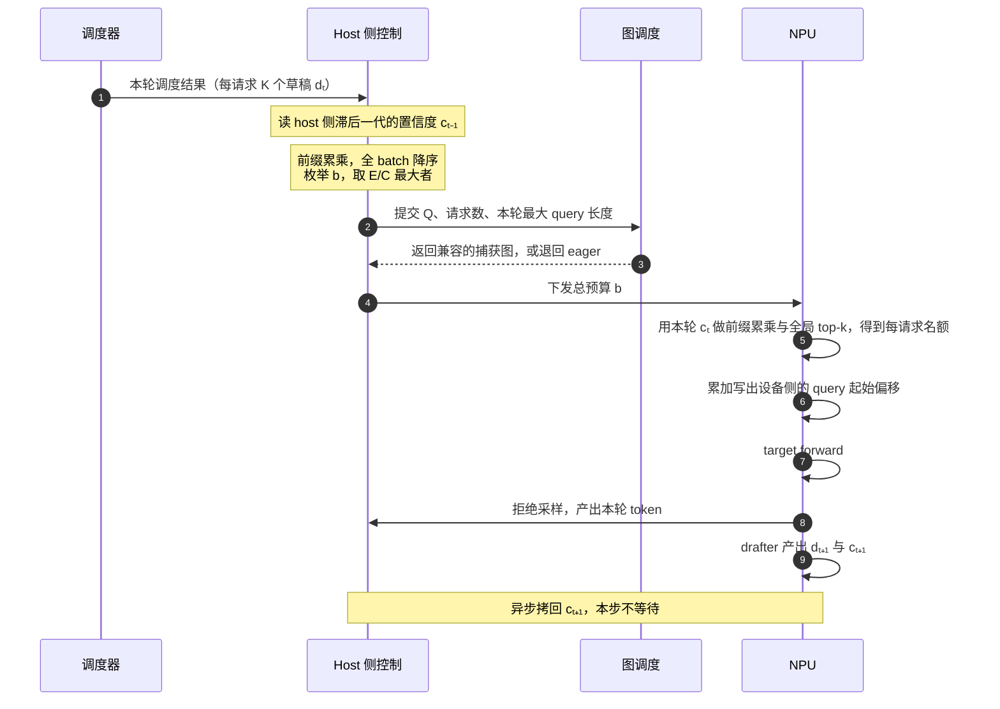
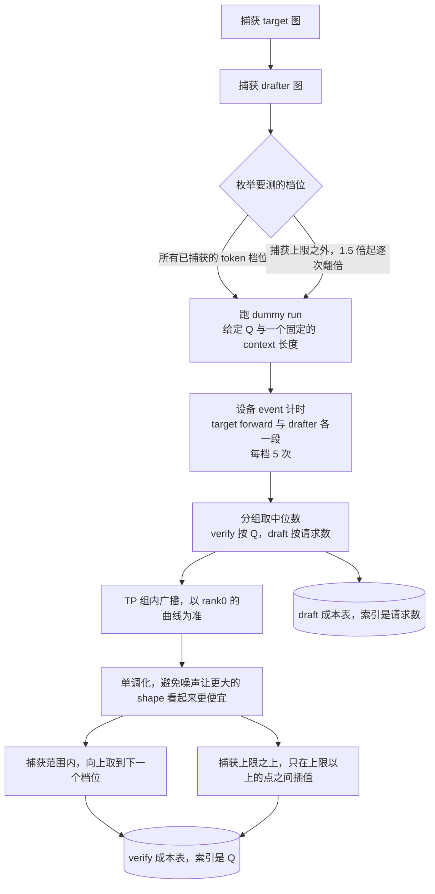
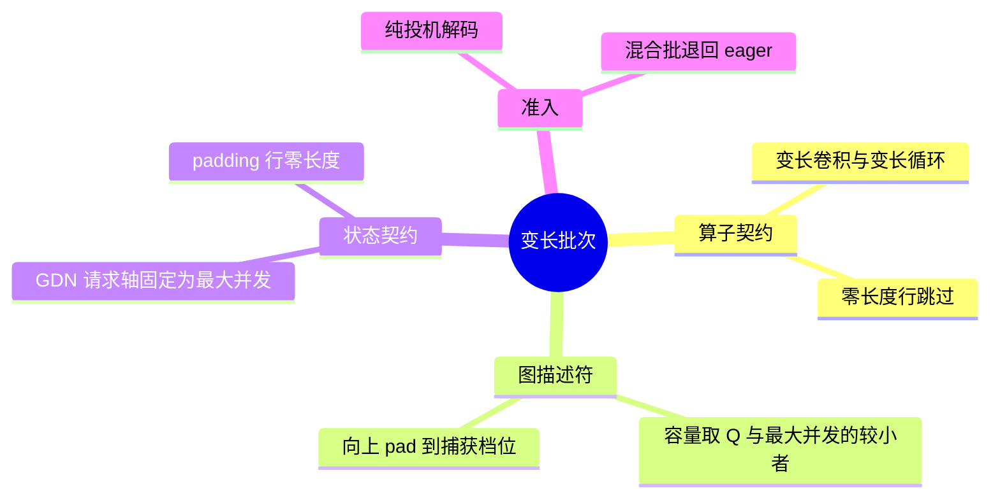

<!-- audit: skip=摘要/关键词,实践过程,成果固化,亮点/局限 -->

# DSpark 动态校验：工作机理、入图条件与影响面

## TL;DR

上游为投机解码提供了 adaptive verification 这一层：草稿模型在产出草稿的同一次前向里额外给出每个位置的置信度，controller 据此逐请求裁掉存活概率低的草稿，让这一步的校验批次变短。D-Cut 作者在 DFlash 侧把同一条路走到了入图，并留下了一份入图契约的复盘。

当前系统已经具备这件事需要的大部分输入：DSpark 的 checkpoint 里带着一个训练好的接受概率预测头、固定 K 的投机解码主干已经在跑、ACL Graph 的捕获与回放也已经可用。缺的是中间那一层结构——裁剪之后每个请求的 query 长度不再相等，而 GDN 算子、图描述符和状态契约都是按「每请求 K+1 个 token」写的，变长批次进不了已经捕获的图。

这里提出的改动有三项：启用 checkpoint 里那个闲置的预测头；新增一对接受变长输入的 GDN 与卷积算子，与固定 K 的算子并存；把 GDN 的请求轴钉死到 `B_max`，让所有图档位共用同一套状态读写契约。混合批不进入变长全图，退回配置本身给的去处。

---

## 1 背景

投机解码每一步让草稿模型提出 K 个候选，target 一次性校验 K+1 个 token。被拒的草稿不产出任何东西，但它占了校验批次的位置。

K 由 checkpoint 固定，这条路径上不可调。所以能动的只有一处：**逐请求地少校验一些注定被拒的草稿。**

上游的 `AdaptiveVerificationManager` 已经提供了这一层的算法骨架：cost table 的 profiling 与构建、预算的枚举与选择、设备侧的名额分配。本文要回答的是它在 Ascend + Qwen3.6 + DSpark 这条路径上的工作机理，以及把它接起来需要动哪些模块。

---

## 2 拆解现状

把视线收回到今天的代码和测量上，会先看到四组比较稳定的规律。

1. **草稿接受率沿位置衰减，而且衰减得很快。** K=7、96 并发下实测，第一个草稿位置的接受率在 77%–84%，第七个落到 13%–27%。
2. **固定 K 下校验宽度与接受情况无关。** 无论某个请求的草稿是不是从第二个位置就开始不准，它这一步仍然占满 K+1 个校验槽位。
3. **eager 模式下单步成本对校验 token 数不敏感。** 参考复盘在某个模型上实测，capture_size 从 16 到 512，eager 单步成本在 76–84 ms 之间几乎水平；同一组配置下 piecewise 为 33.88 / 39.76 / 43.98 / 59.06 ms，随尺寸单调。原文只写了「measured on one model」，没有型号也没有并行度，所以这里只引用它的相对关系。
4. **图按固定的几个尺寸预先捕获，批次向上 pad 到下一档再回放。** 捕获档位之间没有中间态。

第 1 条和第 2 条合起来，给出了可裁剪的空间。以 ceval 为例，第 5 到第 7 个位置合计贡献 0.54 个 token，占掉 3/7 的校验槽位；gsm8k 上同样三个位置贡献 1.00 个 token。

第 3 条和第 4 条合起来，限定了这个空间在什么条件下能兑换成时间。

---

## 3 猜想

> 如果能按每个草稿位置的存活概率逐请求裁掉低价值的候选，并且裁剪后的批次仍然能回放一张已捕获的图，那么单步时间会下降；代价是接受长度下降，净收益取决于两者的比值。

这个猜想里有两个前置条件没有被验证：

- **条件 A**：存在一个可用的「这个草稿位置值不值得校验」的信号，且它的开销小于它换来的收益。
- **条件 B**：裁剪之后的批次，在几何上仍然满足已捕获图的契约。

后面四节分别回答这两个条件怎么落到实现上，以及一个在设计阶段没有被预见到的约束。

---

## 4 预算是怎么算出来的

对应条件 A。

### 4.1 信号来自一个训练好的预测头

`DSparkConfidenceHead` 是一个线性投影接 sigmoid，输出每个草稿位置被接受的概率。它来自 checkpoint，不是草稿分布的 softmax 最大值，也不是已经拿到的校验结果。

单个位置的概率要前缀累乘才能用于排序——前面的候选不通过，后面的位置不会被执行到：

```
存活概率  s[i,j] = p[i,0] × p[i,1] × … × p[i,j]
```

### 4.2 预算是一个比值的 argmax

```
预期收益  E(b) = N_sampling + （全 batch 的 s 降序排列后，前 b 项之和）
预计耗时  C(b) = draft_cost[B] + verify_cost[Q₀ + b]
本轮预算  b*   = argmax_b  E(b) / C(b)
```

`B` 是本轮请求数，`Q₀` 是必须执行的非草稿 token 数，纯 decode 时等于 `B`；`N_sampling` 是本轮会产出采样 token 的请求数。

有两处容易读漏：

- `draft_cost[B]` 在同一个 batch 内对所有 `b` 是常数——DSpark 无论预算多少都会生成完整的 K 个候选，裁剪只发生在校验侧。但它留在分母里，所以固定开销越大，多留几个 token 来摊薄它越划算。
- 目标是单位时间产出，不是「省下的时间」。

### 4.3 预算与名额是两次决策，用的是两代置信度

记第 t 步 drafter 产出的草稿为 `dₜ`、置信度为 `cₜ`，`dₜ` 在第 t+1 步被校验。



host 用 `cₜ₋₁` 定总量，设备用 `cₜ` 分名额。这个代差是设计上的选择：host 因此不必阻塞等待刚刚下发的 drafter。代价是 CPU 侧的置信度相对待校验的那批草稿又滞后一代。新请求进入时两份置信度都置为 1.0，第一轮按「全部会被接受」处理。

存活概率沿位置单调不增，所以设备 top-k 选中的一定是每个请求的前缀，不会出现中间留洞的草稿集合。

关于条件 A 的开销部分：第一版接入时整网 TPOT 回归 11%，定位到 `record_confidences` 里一次阻塞的 D2H 拷贝——host 这一步并不需要刚算出来的那份数据。改成侧流异步拷贝加设备侧修复非法值后，单步从 18.10 ms 回到 16.09 ms。

---

## 5 cost table 是怎么来的

`C(b)` 查的是两张启动时构建、之后不再更新的表。



几处影响后续判断的细节：

1. **测的是图准备好之后跑 dummy workload 的耗时**，不是编图耗时。计时边界是设备流上的两个 event：一段包住 target 的模型执行，一段包住 drafter 的 propose。
2. **它不是端到端时延。** 排队、调度器的 CPU 工作、在线的预算计算、真实的拒绝采样都不在这段区间里。设备 event 之间的间隔会把 host 下发造成的空隙算进去。
3. **捕获上限之外的档位也要测**，因为线性外推会低估那些走 piecewise 或 eager 的点。插值不跨越图边界——越过捕获上限是整张图失效，混合两侧会抹掉这个跳变。
4. **它是一维近似。** verify 表只以 Q 为索引，不区分每请求的上下文长度、长度分布或实际执行模式，运行时也不重标定。profiling 时每个 dummy 请求的历史长度是一个固定配置值，受 `max_model_len` 限制。

第 4 点对 Qwen3.6 这类混合结构的影响有限：GDN 这类线性注意力层的状态大小固定，与上下文长度无关，上下文只影响少数 full-attention 层。

本分支在 `max_num_seqs=16`、graph_limit=128 下实测的表，可达区间 Q=1 为 29.05 ms、Q=128 为 59.25 ms，跨度 30.20 ms。

还有两处偏差来源来自源码分析，标注为推断，尚未在设备上验证：

1. **profiling 的上下文可能没有进到 FIA。** `AscendInputBatch.make_dummy` 把 `seq_lens_np` 设为 query 长度，而上游的 `set_dummy_context` 只修改设备侧 `seq_lens` 与 CPU 上界，没有修改 `seq_lens_np`；FIA 的 `actual_seq_lengths_kv` 走的恰好是这条 host 链路。若推断成立，表里 full-attention 的那部分测的是 context 约等于 query 长度的耗时，会低估 verify 成本随 Q 增长的斜率，使曲线偏平、`argmax` 偏向不裁。验证方式：分别用 `=0` 与 `=8192` 启动，对比启动日志里 cost table 那一行，两者相同即说明上下文没有生效。
2. **FIA 路径每步有两次阻塞 D2H 回读**（`query_start_loc` 与 `seq_lens`）。上游在 CUDA 上到设备端写完偏移就结束，attention 直接读设备值；FIA 需要 host 端的长度列表，因此多了这两次同步。cost table 只覆盖设备 forward 区间，不含这部分，而它随裁剪发生而发生。

---

## 6 裁剪在什么条件下兑换成时间

第 2 节第 4 条规律在这里有了一个更具体的后果。

捕获范围内 cost table 是 Q 的阶梯函数，**台阶的边界就是那些捕获档位**。假设捕获了 56 和 64 两档，当前这一步有 64 个校验 token：

```
verify 成本
   │                  ┌─────────────   Q 落在 (56, 64] → 一律按 64 这一档计价
   │                  │
   │     ┌────────────┘                Q 落在 (48, 56] → 一律按 56 这一档计价
   │     │
   └─────┴────────────┴──────────────→  Q
        48           56              64

   Q=64 → 裁到 60：仍然落在 (56, 64]，回放的还是 64 那张图
   Q=64 → 裁到 56：降一档，回放 56 那张图
```

裁掉 4 个 token 换不到任何时间，裁掉 8 个才开始换得到。由此得到三条：

1. **收益是台阶式的。**「这一步裁掉了 6% 的草稿」与「这一步省了 6% 的时间」之间没有对应关系。
2. **档位的疏密决定收益的可得性。** 档位越密越容易跨过台阶；档位越疏，需要裁掉越多才换得到一次降档，而裁得越多接受长度损失越大。
3. **`E/C` 的比值形式在做的就是这件事。** 它逐个候选预算地问：这个 `b` 能不能换到更低的一档，换到之后收益值不值被砍掉的那些 token。

形式化地说，同一个桶内 `C(b)` 恒定而 `E(b)` 随 b 单调增，所以 `argmax` 落在某个桶的上沿。controller 做的决策是「选哪一档图」。

举一个把这段算出来的例子：2 个请求、K=3、`draft_cost[2]=3.0 ms`，verify 表为 `Q=2 → 10.0`、`Q=3..4 → 10.5`、`Q=5..8 → 16.0`，两个请求的存活概率为 A `[0.90, 0.72, 0.36]`、B `[0.20, 0.10, 0.05]`：

| b | Q | C(b) | E(b) | E/C |
| --- | --- | --- | --- | --- |
| 0 | 2 | 13.0 | 2.00 | 0.154 |
| 1 | 3 | 13.5 | 2.90 | 0.215 |
| 2 | 4 | 13.5 | 3.62 | **0.268** |
| 3 | 5 | 19.0 | 3.98 | 0.209 |
| 6 | 8 | 19.0 | 4.33 | 0.228 |

最优点 b=2 落在 `Q=3..4` 的上沿：b=1 与 b=2 成本相同，没有理由选 b=1；b=3 跨进 19.0 那一档，多出来的 0.36 个期望 token 换不回 5.5 ms。把 `Q=5..8` 改成 12.0，最优点移到 b=6，也就是不裁剪——台阶不够高时，不裁剪是这个目标函数的正确输出。

---

## 7 变长批次怎么进图

这一节表面上在讲 GDN 算子和图描述符，要回答的是条件 B：**裁剪后的批次应该以什么形状存在，才仍然满足已捕获图的契约。**



一个批次从调度到回放的生命周期：

```
调度结果 → 预算 b* → Q=Q₀+b* → 图匹配 → 几何检查 → 回放或退回 eager
                                      │
                                      ├─ 纯投机解码？否 → 退回 eager
                                      ├─ 请求轴 = B_max？
                                      └─ padding 行零长度且状态索引无效？
```

### 7.1 算子要接受逐请求不同的长度

固定 K 路径上的两个 AscendC 算子都隐含「每请求恰好 K+1 个 token」。差异集中在两个入参：

| | 固定 K 路径 | 变长路径 |
| --- | --- | --- |
| 长度 | `actual_seq_lengths` | `query_start_loc`，cumsum，可逐请求不同，可为 0 |
| 状态索引 | `.flatten()` | 保留 `[B, S]` 二维 |

`.flatten()` 之后寻址只能按固定 stride `K+1` 隐式推算，每个请求必须恰好 K+1 个 token。保留二维之后，每行用掉的列数才可以不同。

契约的本质是两个轴解耦：本轮的 query 长度可变，而状态表的 stride 与 `num_accepted_tokens`（上一轮的产出数，用作历史选择器）不随本轮宽度缩短，并且允许大于本轮宽度。卷积侧把滚动后的历史固定写到 offset 0，于是下一轮可以选任意 accepted 前缀。

### 7.2 有状态算子的请求轴不能跟着图尺寸走

对无状态算子，shape 变小通常只影响速度。GDN 是循环状态算子，请求轴一变，状态的读写位置随之改变。

参考复盘记录的故障形态是：让 GDN 请求轴跟随图尺寸时，单机稳定并发下正常，并发由小到大爬升时不同图的 stateful tiling 与请求轴反复变化，前面几批请求短输出或乱码，并发稳定后自行恢复。不抛错，并且会自愈。

这里需要区分的量有六个，把它们当成同一个数字是主要的错误来源：

| 名称 | 含义 |
| --- | --- |
| `B_max` | 服务允许的最大请求数 |
| `B_live` | 当前这一轮真实存在的请求数 |
| `Q` | 本轮实际处理的总 query token 数 |
| `B_graph` | 图描述符能容纳的请求数 = `min(Q, B_max)` |
| `B_fia` | Full Attention 看到的请求行数 = `B_live`，有 token padding 时 `B_live + 1` |
| `B_gdn` | GDN 状态算子的请求轴 = `B_max`，所有档位统一 |

与之配套的是 padding 行的处理：行被保留，不被截断。FIA 为每个 padding 请求保留满 K+1 的 query span，GDN 必须把同样的行看成零长度、状态索引为 pad 哨兵，算子跳过，padding token 不写入任何真实 KV 或状态。

### 7.3 混合批的准入与去处

变长全图的契约是纯投机解码。判别方式是比较「本轮被调度的请求」与「本轮带投机草稿的请求」两个集合的大小，一个正在 prefill 的请求出现在前者而不在后者，两者在批次混合时不等。

去处的选择会影响后续测量的口径。被拒绝的批次落到配置本身给的去处，在 `FULL_DECODE_ONLY` 下是 eager，而不是额外开一套 piecewise 图。理由有两条：多编一整套图的显存开销不可接受；动态校验关闭时混合批同样走 eager，若只让开启时享有 piecewise，测出来的差值里会混进一个配置选择。

代价是这部分批次的时间仍在图外。把 prefill 与 decode 拆成独立微批是后续方向。

---

## 8 回到两个条件

前面提出的两个前置条件，到这里可以给出回答。

**条件 A 成立，但它的开销需要单独处理。** 信号来自 checkpoint 里的预测头，不需要额外训练；代价是一次 D2H 拷贝，同步做会让 TPOT 上升 11%，异步化之后这项开销不再出现在关键路径上。

**条件 B 成立，但它附带一条设计阶段没有预见到的约束。** 几何上的要求可以通过变长算子加固定请求轴满足，而第 6 节表明，满足几何只是必要条件——批次还要跨过一个捕获档位，裁剪才兑换得到时间。这条约束改变了对收益规模的预期，也改变了评估方式：应该统计的是有多少步真的降了档，而不是平均裁掉了多少草稿。

---

## 9 影响面

已经存在、本次直接复用的模块：

- 上游 `AdaptiveVerificationManager`：cost table 的 profiling 与构建、预算枚举、设备侧 top-k
- DSpark 在 Ascend 上的投机解码主干，以及 PR 15098 带来的固定地址 buffer 与批收缩时的 inactive tail 清理
- ACL Graph 的捕获与回放

本次改动涉及的模块：

- GDN 与卷积算子：新增一对接受 `query_start_loc` 与二维状态索引的实现，与固定 K 的实现并存，由配置分流
- GDN metadata builder：投机分支的请求轴改为 `max_num_seqs`，并对超宽批次加断言
- 逐请求 buffer：宽度加一行，容纳 FIA 的 padding 请求
- model runner：批次纯度判别与混合批拒绝；拒绝的实现不复述 vLLM 的字段表与函数签名，改用 `dataclasses.replace` 分流
- 置信度路径：侧流异步拷贝、设备侧非法值修复、按窗口聚合的诊断输出

只体现出局部规律、后续可能替代的实现：

- 混合批退回 eager 是当前的选择，prefill / decode 微批拆分是更完整的替代
- cost table 的一维近似在长上下文部署下与真实耗时的偏离幅度未知
- 清单里的「概率绑定 graph descriptor，每轮只消费一次」未实现，影响随机采样路径

需要补偿或迁移的点：

- drafter 未使用的 KV tail 的 slot mapping 置无效一项未做。残留写入的是 draft KV，在 greedy 下被拒草稿由 target 的 argmax 取代，不改变输出，但会压低接受率
- FIA sink 接 `UpdatableGraph` 的钩子在一次 rebase 中丢失

---

## 10 可观测性与 eval

### 10.1 运行时要能看到什么

只看吞吐数字，无法区分「动态校验生效了」和「它被构造出来但从未裁剪」。更麻烦的一种失效形态是置信度静默冻结：出图后 confidence 算子只有被 trace 进捕获的草稿图才会每次回放都重算，一个在捕获时为假的分支会把它留在图外，buffer 冻在捕获前的值。此时裁剪仍然是一个策略、拒绝采样仍然正确，输出与固定 K 逐 token 一致，唯一的症状是「这个特性看起来没效果」。

因此按窗口聚合输出三个量，每 `interval` 步一行：

1. 本窗口保留的草稿比例
2. 本窗口每一步实际派发到的图模式
3. 置信度发生过变化的步数

判定条件是三者同时成立：出现保留比例低于 100% 的窗口、这些窗口的步命中全图、置信度每步都在变化。任一不成立记为无效运行。

第 6 节带来一个待补的观测点：**当前的保留比例不区分「裁了但没降档」和「裁了并且降了档」。** 需要补一个降档计数，否则收益与裁剪强度之间的关系无法从日志里读出来。

### 10.2 eval 命题

第一组计算**流通性**。一个批次的草稿进入系统之后：

- 有多少被预算筛选掉
- 有多少被设备 top-k 命中
- 有多少触发了降档
- 最后有多少升级成被接受的 token

第二组计算**稳定性**。同一配置重复运行：

- 输出是否可复现
- 可裁空间是否随并发变化
- 置信度的判别力是否随上下文长度衰减

第二组里的第一项已经有结论，而且结论是否定的：在服务规模的并发下，关闭动态校验的参考实现自己就不可复现，同一引擎内多次采样会产出不同输出，最早分歧可以出现在第 2 个 token。这一项直接影响正确性判据的选择——逐 token 相等在这个量级上不是一个可用的判据，验收需要改成与参考集比对。

---

## 11 结果

先交代口径。对比的两条路径是同一引擎、同一模型、同一数据集、同一并发，唯一差异是是否开启动态校验；基线是固定 K 的投机解码路径，不调用动态校验的任何代码。两个指标都取整次运行的汇总平均：TPOT 按全部解码 token 平均，端到端按并发批平均。

两者包含 prefill、排队、调度、采样、拒绝采样、状态更新与通信，也就是服务侧能观测到的全部时间。它们**不包含**的部分需要单独点明：第 5 节那张 cost table 测的是设备事件之间的两段，不含排队、调度器的 CPU 工作、在线预算计算与真实的拒绝采样。两者差一个量级，不能相减，也不能互相换算。

每个格子是一次运行的结果，**预热次数、重复采集次数与波动范围没有记录**，因此没有噪声底可以引用。这限制了可以下的结论：32 并发及以上的改善在 3%–13.6% 量级、跨 4 个数据集同向，不像噪声；16 并发那一档只有 0.9%–1.8%，在没有噪声底的情况下只能说明收益接近零，不足以断定符号。

4 个数据集、5 档并发的对照。TPOT 单位 ms，端到端单位 s，接受长度为每请求每步产出的 token 数。变化列为负表示开启后更快。

| 数据集 | 并发 | TPOT 关闭 | TPOT 开启 | TPOT 变化 | 端到端 关闭 | 端到端 开启 | 端到端变化 | 接受长度 关闭 | 接受长度 开启 |
| --- | ---: | ---: | ---: | ---: | ---: | ---: | ---: | ---: | ---: |
| **ceval** | 96 | 48.87 | 42.90 | −12.2% | 228.1 | 199.7 | −12.4% | 3.60 | 3.19 |
|  | 64 | 46.75 | 41.24 | −11.8% | 243.7 | 214.3 | −12.1% | 3.60 | 3.24 |
|  | 48 | 40.51 | 36.02 | −11.1% | 279.6 | 253.6 | −9.3% | 3.60 | 3.36 |
|  | 32 | 31.84 | 29.12 | −8.5% | 339.5 | 301.7 | −11.1% | 3.58 | 3.26 |
|  | 16 | 21.24 | 21.52 | +1.3% | 447.5 | 452.6 | +1.1% | 3.60 | 3.42 |
| **gsm8k** | 96 | 44.56 | 42.48 | −4.7% | 166.2 | 161.7 | −2.7% | 4.54 | 4.32 |
|  | 64 | 39.73 | 38.24 | −3.8% | 170.3 | 167.3 | −1.8% | 4.51 | 4.14 |
|  | 48 | 35.35 | 33.12 | −6.3% | 194.5 | 184.4 | −5.2% | 4.55 | 4.28 |
|  | 32 | 28.00 | 27.08 | −3.3% | 241.0 | 233.0 | −3.4% | 4.51 | 4.40 |
|  | 16 | 19.20 | 19.42 | +1.1% | 320.0 | 325.8 | +1.8% | 4.54 | 4.38 |
| **coding_zh** | 96 | 47.77 | 42.16 | −11.7% | 596.9 | 555.8 | −6.9% | 3.78 | 3.37 |
|  | 64 | 45.34 | 39.18 | −13.6% | 656.0 | 571.0 | −13.0% | 3.79 | 3.38 |
|  | 48 | 36.27 | 31.64 | −12.8% | 704.3 | 615.1 | −12.7% | 3.78 | 3.47 |
|  | 32 | 28.03 | 25.65 | −8.5% | 816.5 | 743.7 | −8.9% | 3.78 | 3.37 |
|  | 16 | 18.88 | 19.21 | +1.7% | 1095.8 | 1114.5 | +1.7% | 3.78 | 3.56 |
| **specbench** | 96 | 58.61 | 52.88 | −9.8% | 611.5 | 556.9 | −8.9% | 3.66 | 3.29 |
|  | 64 | 51.86 | 45.94 | −11.4% | 579.6 | 510.1 | −12.0% | 3.67 | 3.32 |
|  | 48 | 43.88 | 39.19 | −10.7% | 654.1 | 586.8 | −10.3% | 3.70 | 3.46 |
|  | 32 | 33.46 | 30.76 | −8.1% | 755.7 | 706.4 | −6.5% | 3.68 | 3.39 |
|  | 16 | 22.11 | 22.31 | +0.9% | 1003.1 | 1008.1 | +0.5% | 3.64 | 3.48 |

每个百分比只对照它自己那一行的关闭值，行与行之间不可相加；TPOT 与端到端是同一组运行的两个口径，不能相减。

读表时有三处与前面各节对得上：

1. **16 并发那一行是轻微退化（+0.5% 到 +1.8%）。** 并发小时单步时间由与 Q 无关的固定开销主导，`E/C` 曲线在可达区间内接近水平，最优点落在不裁附近，而预算枚举与设备 top-k 的开销仍然要付。
2. **32 并发以上进入平台，不随并发继续上升。** 可降的档位由可裁空间（逐位置接受率，不随并发变化）与捕获档位的疏密共同决定，并发增大只是把 Q 推到更高的区间。
3. **gsm8k 在所有并发下收益最小。** 它的第 5–7 个草稿位置贡献 1.00 个 token，ceval 只有 0.54 个，可裁空间差了近一倍。接受长度的降幅也最小（4.8%，其余三个数据集 10.1%–11.4%），两者逐数据集对应。

96 并发那一行的端到端需要单独说明：该档位基线的 TTFT 为 19.7–58.2 s，48 与 64 并发只有 0.9–1.6 s。端到端把这段 prefill 排队也计入，而动态校验只作用于解码侧，所以该行的端到端改善小于同行的 TPOT 改善。

---

## 12 边界

- **16 并发附近是收益的临界区。** 本分支在另一个数据集、另一个指标下测到过小幅正收益，与上表符号相反。在这个量级上收益接近零且符号不稳定，需要在低并发下部署时应当按自己的数据集重测。
- **收益有上限。** 可裁空间由逐位置接受率决定，加大批次不改变它。进一步提升的方向是提高预测头的判别力，或者减少第 5 节里那些与 Q 无关的固定开销。
- **混合批仍在图外。**
- **cost table 是启动时的一维近似**，长上下文部署下与真实耗时的偏离需要用实际 workload 验证。
- **结论限于 greedy 采样。**

## 13 下一步

1. 确认 profiling 的上下文是否进到了 FIA（第 5 节第 1 条推断）。这一项最便宜，只需要两次启动对比日志，而它直接影响 cost table 的 Q 梯度是否被系统性压平。
2. 补降档计数，把「裁了」与「降了档」在日志里分开（第 10.1 节）
3. 在算子级 profile 上确认单步时间里与 Q 无关的那部分由什么构成，其中 FIA 的两次阻塞回读（第 5 节第 2 条）是已知的候选
4. 拆分 prefill 与 decode 微批，回收混合批这部分时间

---

## 附：材料来源

- 第 4、5 节的工作机理对照了两份源码分析：[discussion #25](https://github.com/singzhou/vllm-ascend/discussions/25)（codex）与 [#26](https://github.com/singzhou/vllm-ascend/discussions/26)（Claude 生成）。两份读的代码快照与本分支不同，引用其结论时对照过部署版本的同名实现；#26 自行标注的「推断」项未经设备验证，本文引用时保留该标注。第 5 节末尾那两条偏差来源（profiling 上下文是否进到 FIA、FIA 侧的两次阻塞回读）都来自 #26 的推断项，尚未验证。
- 第 11 节的数据来自同团队的对照测量，见 [discussion #27](https://github.com/singzhou/vllm-ascend/discussions/27) 及其附表。
- 入图契约部分依据 D-Cut 作者在 DFlash 侧的复盘，对应 PR 15147、15207。[待补：文章链接]
- 上游动态校验实现对应 vllm#47808；Ascend 侧投机解码主干对应 vllm-ascend PR 15098。
